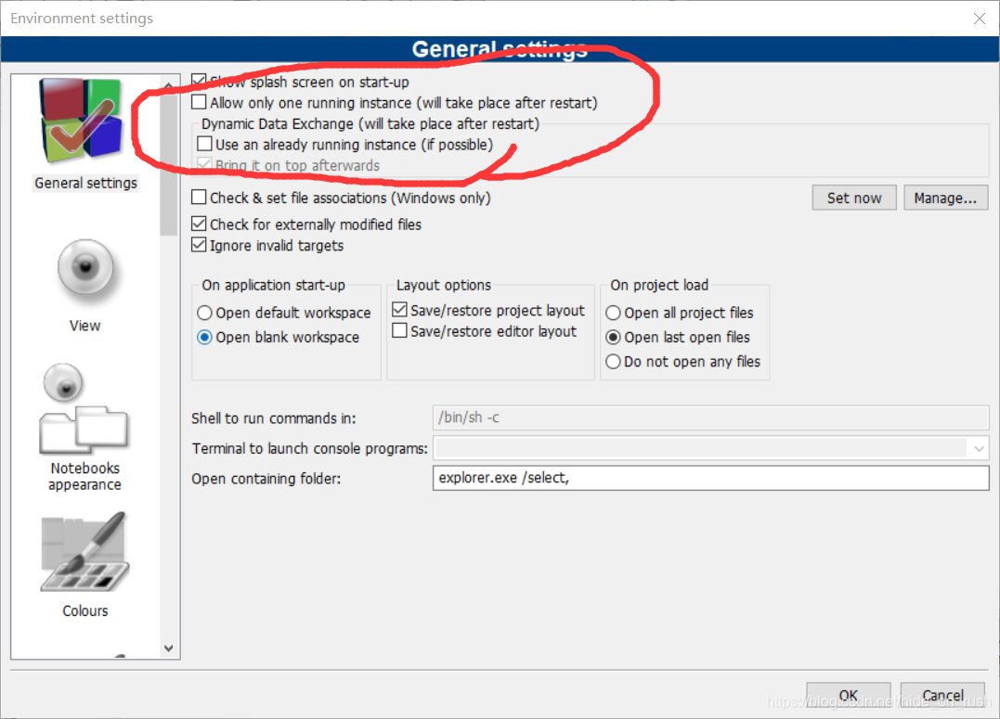

> 迁移来源 [博客园原文](https://www.cnblogs.com/xiuzhublog/p/13501759.html) · 原文发布于 `2020-08-14 13:42:00`（UTC+8）
> 旧文归档，保留当时的记录。

## 编译错误

会出现好多undefined reference to'WSAStartup to@8之类的错误，都是undefind开头的

### 解决方法：

Settings -> Compiler settings -> Global compiler settings-> Linker settings，点击Add按钮  
找到这个文件C:\ProgramFiles (x86)\CodeBlocks\MinGW\lib\libws2\_32.a，添加就好了。  
（如果找不到可以在codeblocks的安装目录下找。还有说添加ws2\_32.lib的，我没有找到，不用也能正常运行）

## 不能同时运行两个程序

要实现组播肯定要一个程序发一个程序收，可是codeblocks运行一个程序后，编译运行的按钮就灰了。  
Settings -> Environment Settings -> General Settings  
去掉这两个的勾选  
  
保存，重启cb。
