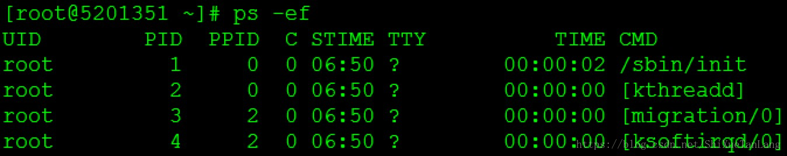
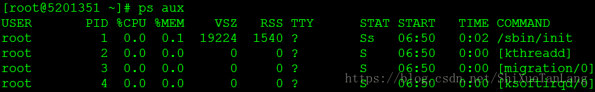

> 迁移来源 [博客园原文](https://www.cnblogs.com/xiuzhublog/p/13783974.html) · 原文发布于 `2020-10-09 08:51:00`（UTC+8）
> 旧文归档，保留当时的记录。

在Linux系统中，ps(Process Status的缩写)命令常常用来用来列出系统中当前运行的进程。ps命令列出的是当前那些进程的快照，就是执行ps命令的那个时刻的那些进程，如果想要动态的显示进程信息，就可以使用top命令。要对进程进行监测和控制，首先必须要了解当前进程的情况，也就是需要查看当前进程，而 ps 命令就是最基本同时也是非常强大的进程查看命令。使用该命令可以确定有哪些进程正在运行和运行的状态、进程是否结束、进程有没有僵死、哪些进程占用了过多的资源等等。总之大部分信息都是可以通过执行该命令得到的。

Linux上进程有5种状态: 

|  |  |  |
| --- | --- | --- |
| 进程状态 | 含义 | 对应ps命令的状态码 |
| 运行 | 正在运行或在运行队列中等待 | R 运行 runnable (on run queue) |
| 中断 | 休眠中, 受阻, 在等待某个条件的形成或接受到信号 | S 中断 sleeping |
| 不可中断 | 收到信号不唤醒和不可运行, 进程必须等待直到有中断发生 | D 不可中断 uninterruptible sleep (usually IO) |
| 僵死 | 进程已终止, 但进程描述符存在, 直到父进程调用wait4()系统调用后释放 | Z 僵死 a defunct (”zombie”) process |
| 停止 | 进程收到SIGSTOP, SIGSTP, SIGTIN, SIGTOU信号后停止运行运行 | T 停止 traced or stopped |

 ps命令有很多参数，具体如下：

|  |  |
| --- | --- |
| 命令 | 含义 |
| e | 显示所有进程,环境变量 |
| f | 全格式 |
| h | 不显示标题 |
| l | 长格式 |
| w | 宽输出 |
| a | 显示终端上地所有进程,包括其他用户地进程 |
| r | 只显示正在运行地进程 |
| x | 显示没有控制终端地进程 |
| u | 以用户为主的格式来显示程序状况 |
| au | 显示较详细的资讯 |
| aux | 显示所有包含其他使用者的行程 |
| -C<命令> | 列出指定命令的状况 |
| --lines<行数> | 每页显示的行数 |
| --width<字符数> | 每页显示的字符数 |
| --help | 显示帮助信息 |
| --version | 显示版本显示 |
|  |  |

ps -ef 与 ps aux

Linux下显示系统进程的命令ps，最常用的有ps -ef 和ps aux。这两个到底有什么区别呢？两者没太大差别，讨论这个问题，要追溯到Unix系统中的两种风格，System Ｖ风格和BSD 风格，ps aux最初用到Unix Style中，而ps -ef被用在System V Style中，两者输出略有不同。现在的大部分Linux系统都是可以同时使用这两种方式的。

ps -ef 是用标准的格式显示进程的、其格式如下:

|  |  |  |  |  |  |  |
| --- | --- | --- | --- | --- | --- | --- |
| UID | PID | PPID | C | STIME | TTY | CMD |
| 用户ID | 进程的ID | 父进程ID | 进程占用CPU的百分比 | 进程启动的时间 | 该进程在那个终端上运行。  若与终端无关，则显示?  若为pts/0等，则表示由网络连接主机进程。 | 命令的名称和参数 |

ps aux 是用BSD的格式来显示、其格式如下：

|  |  |  |  |  |  |  |  |  |  |  |
| --- | --- | --- | --- | --- | --- | --- | --- | --- | --- | --- |
| USER | PID | %CPU | %MEM | VSZ | RSS | TTY | STAT | START | TIME | COMMAND |
| 用户名 | 同上 | 进程占用的CPU百分比 | 占用内存的百分比 | 该进程使用的虚拟內存量（KB） | 该进程占用的固定內存量（KB）  （驻留中页的数量） | 同上 | 进程的状态 | 同上 | 该进程实际使用CPU运行的时间 | 同上 |

其中STAT状态位常见的状态字符有
  
D      //无法中断的休眠状态（通常 IO 的进程）； 
  
R      //正在运行可中在队列中可过行的； 
  
S      //处于休眠状态； 
  
T      //停止或被追踪； 
  
W      //进入内存交换 （从内核2.6开始无效）； 
  
X      //死掉的进程 （基本很少见）； 
  
Z      //僵尸进程； 
  
<      //优先级高的进程 
  
N      //优先级较低的进程 
  
L      //有些页被锁进内存； 
  
s      //进程的领导者（在它之下有子进程）； 
  
l      //多线程，克隆线程（使用 CLONE\_THREAD, 类似 NPTL pthreads）； 
  
+      //位于后台的进程组；

## ps -ef | grep

命令解释  
ps命令将某个进程显示出来  
grep命令是查找  
中间的|是管道命令 是指ps命令与grep同时执行  
PS是LINUX下最常用的也是非常强大的进程查看命令  
grep命令是查找，是一种强大的文本搜索工具，它能使用正则表达式搜索文本，并把匹配的行打印出来。  
grep全称是Global Regular Expression Print，表示全局正则表达式版本，它的使用权限是所有用户。  
以下这条命令是检查java 进程是否存在：ps -ef |grep java

字段含义如下：  
UID PID PPID C STIME TTY TIME CMD

zzw 14124 13991 0 00:38 pts/0 00:00:00 grep –color=auto dae

UID ：程序被该 UID 所拥有

PID ：就是这个程序的 ID

PPID ：则是其上级父程序的ID

C ：CPU使用的资源百分比

STIME ：系统启动时间

TTY ：登入者的终端机位置

TIME ：使用掉的CPU时间。

CMD ：所下达的是什么指令
