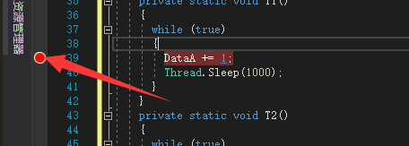
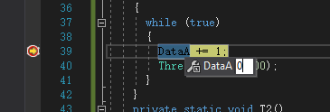
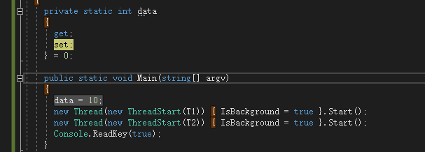
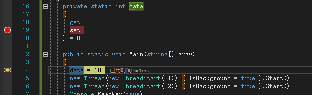
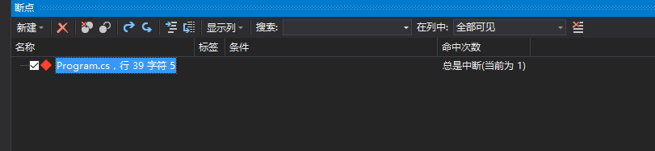
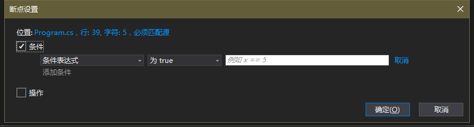
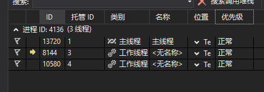
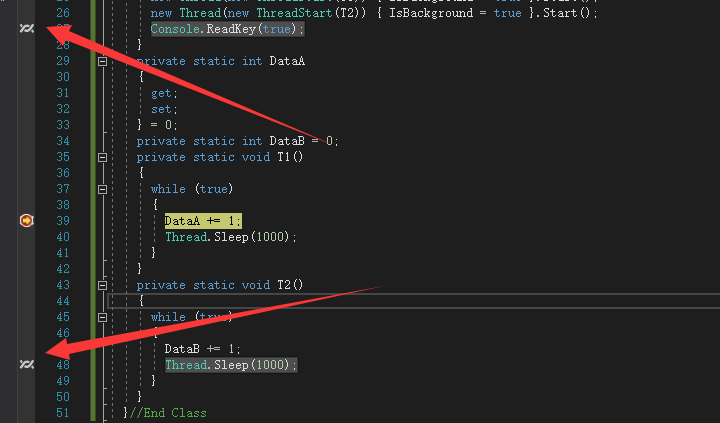
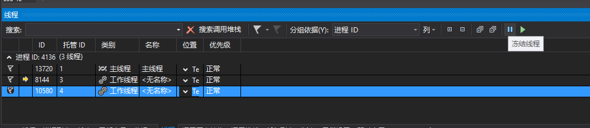
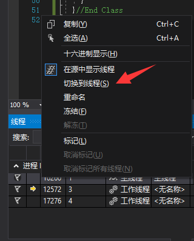

> 迁移来源 [博客园原文](https://www.cnblogs.com/xiuzhublog/p/13864387.html) · 原文发布于 `2020-10-23 15:24:00`（UTC+8）
> 旧文归档，保留当时的记录。

[VS2017调试技巧](https://www.cnblogs.com/Leo_wl/p/7877527.html)

> 阅读目录
>
> - [一、查看或修改变量的值](https://www.cnblogs.com/Leo_wl/p/7877527.html#_label0)
> - [二、控制线程下一步要执行的代码位置](https://www.cnblogs.com/Leo_wl/p/7877527.html#_label1)

阅读目录

- [Visual Studio的调试技巧](https://www.cnblogs.com/Leo_wl/p/7877527.html#_label0)
- [演示环境:](https://www.cnblogs.com/Leo_wl/p/7877527.html#_label1)
- [演示用的代码:](https://www.cnblogs.com/Leo_wl/p/7877527.html#_label2)
- [基本概念:断点](https://www.cnblogs.com/Leo_wl/p/7877527.html#_label3)
- [在数据被改变/读取的时候挂起(面向对象版数据断点)](https://www.cnblogs.com/Leo_wl/p/7877527.html#_label4)
- [多线程调试](https://www.cnblogs.com/Leo_wl/p/7877527.html#_label5)

[回到目录](https://www.cnblogs.com/Leo_wl/p/7877527.html#_labelTop)

## [Visual Studio的调试技巧](http://www.cnblogs.com/DragonStart/p/7843977.html)

调试技巧是衡量程序员水平的一个重要指标.掌握好的调试技巧与工具的使用方法,也是非常重要的.  
\*\*\*

[回到目录](https://www.cnblogs.com/Leo_wl/p/7877527.html#_labelTop)

## 演示环境:

VS2017  
C#  
\*\*\*

[回到目录](https://www.cnblogs.com/Leo_wl/p/7877527.html#_labelTop)

## 演示用的代码:

```csharp
1. public class Program
2. {
3. private static int data { get; set; } = 0; public static void Main(string[] argv) { data = 10; new Thread(new ThreadStart(T1)) { IsBackground = true }.Start(); new Thread(new ThreadStart(T2)) { IsBackground = true }.Start(); Console.ReadKey(true); } private static int DataA { get; set; } = 0; private static int DataB = 0; private static void T1() { while (true) { DataA += 1; Thread.Sleep(1000); } } private static void T2() { while (true) { DataB += 1; Thread.Sleep(1000); } } }//End Class
```

---

[回到目录](https://www.cnblogs.com/Leo_wl/p/7877527.html#_labelTop)

## 基本概念:断点

这是最基本的操作了,想必大伙都会了...  
我们可以点击编辑器的这个地方:  
  
给代码添加一个断点,这样当代码执行到这里的时候就会挂起进程,此时代码会暂停执行,并等待用户操作.

### 如何继续?

可按以下快捷键其中一个来实现继续:  
F5(继续执行,直到再次遇到断点,或者按Ctrl+Alt+Break键强行中断)  
F10(步过,继续执行,但是到下一行又会挂起,不管下一行有没有断点)  
F11(步入,和步过同效,但如果当前挂起位置是一个函数的话,下一步会进到函数里)  
Shift+F11(步出,执行到当前函数返回)

### 挂起的生效范围

这个挂起,是对整个进程生效的,也就是说所有线程都会暂停.  
挂起状态:  


### 在挂起的时候能做的事

[返回顶部](https://www.cnblogs.com/Leo_wl/p/7877527.html#_labelTop)

#### 查看或修改变量的值

如同图中那样,当鼠标指针指向变量名的时候,可以查看或修改该变量的值,修改完要按回车确认.  
该操作仅限当前位置作用域内的变量.

[返回顶部](https://www.cnblogs.com/Leo_wl/p/7877527.html#_labelTop)

#### 控制线程下一步要执行的代码位置

看图中左边的小箭头,其实是能拖动的!可以把他往上或往下拖,从而改变线程下一步要执行的代码位置,但是有两点要注意:  
1:位置改变了,但是操作过的变量值不会改变,所以别指望能用来倒退已经执行过的操作.  
2:改变是有范围的,不能跳到别的函数,就算是局部函数,也不能跳到外面.

[回到目录](https://www.cnblogs.com/Leo_wl/p/7877527.html#_labelTop)

## 在数据被改变/读取的时候挂起(面向对象版数据断点)

有时候代码执行到某地方,某个变量就会被莫名其妙的改了.这时候我们需要找出来是哪里改了这个变量.  
VS有提供一个叫做[数据断点]的东西,但那个只支持native类的语言,C#是不行的.  
但有个不是很完美的方法:  
我们可以给目标变量加上get;set;访问器,然后在上面加断点,看开头的代码:

```csharp
1. private static int data
2. {
3. get; set; } = 0;
```

效果如下:  


这时候按住Ctrl键不放,接着连续按D T键,就能呼出调用堆栈窗口,看是哪里在尝试修改这个变量,也可以按Shift+F11,执行到返回,这样就能直接跳到修改这个变量的代码:  
  
说这个方法不完美是因为它对没有代码的其它dll里的全局变量无法使用.

### 给断点加条件

当我们在循环里打断点的时候,断点会被循环触发,这样调试起来就很麻烦了,我们可以给断点加条件,让断点满足条件才触发.  
按住Ctrl键不放,接着连续按D B键,能看到所有断点的列表.  
  
在目标断点按下鼠标右键,在菜单里选择设置.可进入断点设置界面:  
  
给条件打上勾.可看到有三种条件模板,三个模板可相与(居然不能相或...)

### 条件表达式:

可以输入一条表达式,以表达式的结果决定是否触发,表达式参数可以是当前断点作用域内的变量或常量,判断方式有两种:  
表达式结果返回true时触发  
表达式结果变化时触发(只支持bool类型结果)  
提醒:如果想要在返回false的情况下触发,可以把表达式改为: !(表达式)

### 命中次数:

代码执行过断点次数达到一定次数才触发,这个模版分为三种类型:  
等于:执行过第x次触发断点  
大于等于:执行过第x次以及之后都触发  
倍数于:代码执行过x的倍数次时触发断点

### 筛选器:

可根据线程ID,线程名,进程ID,进程名,机器名,等条件决定是否断下线程.各条件之间可进行逻辑操作  
\*\*\*\*\*\*

[回到目录](https://www.cnblogs.com/Leo_wl/p/7877527.html#_labelTop)

## 多线程调试

按住Ctrl键不放,接着连续按D T键,能显示[线程]窗口,可从中看到当前调试进程的所有线程.  


### 查看所有线程当前位置

点菜单栏的这个地方,能显示所有线程挂起时的位置:  
  
效果如下:  


### 冻结一个线程

这时候我们可以单独冻结一个线程,让这个线程被单独挂起,其它线程继续调试,选择线程,然后点这里:  
  
如你所见,解冻按钮就在旁边...  
线程被冻结后,就会被单独挂起,直到解冻才继续执行.

### 切换线程

如果当前挂起的线程不是自己要调试的线程,可以在这里切换到别的线程:  


分类: 
[[15]Dev Tools](http://www.cnblogs.com/Leo_wl/category/225690.html)
