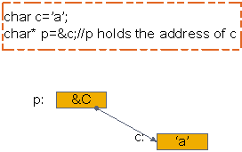
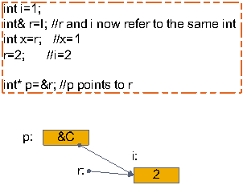
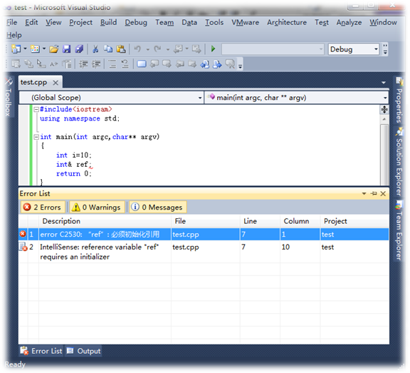
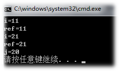
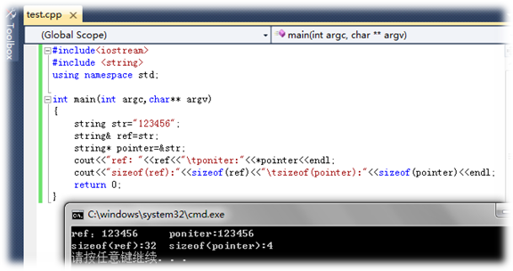
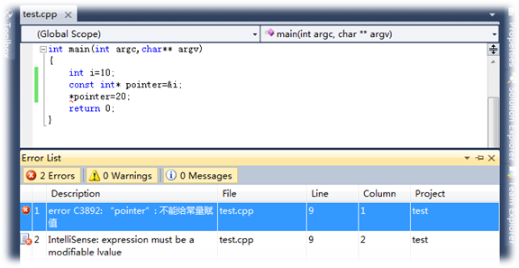
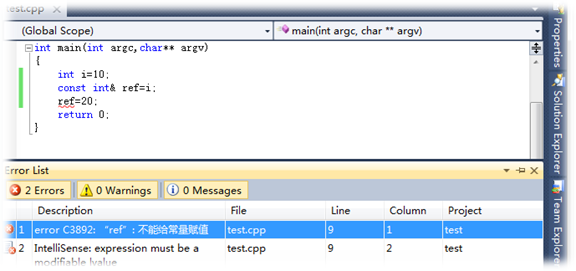
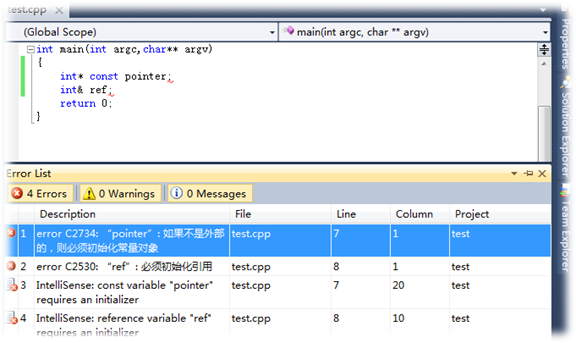

> 迁移来源 [博客园原文](https://www.cnblogs.com/xiuzhublog/p/14046083.html) · 原文发布于 `2020-11-27 08:48:00`（UTC+8）
> 旧文归档，保留当时的记录。

下面用通俗易懂的话来概述一下：

- 指针-对于一个类型T，T\*就是指向T的指针类型，也即一个T\*类型的变量能够保存一个T对象的地址，而类型T是可以加一些限定词的，如const、volatile等等。见下图，所示指针的含义：

  
- 引用-引用是一个对象的别名，主要用于函数参数和返回值类型，符号X&表示X类型的引用。见下图，所示引用的含义：

  

## 2、指针和引用的区别

- 首先，引用不可以为空，但指针可以为空。前面也说过了引用是对象的别名，引用为空——对象都不存在，怎么可能有别名！故定义一个引用的时候，必须初始化。因此如果你有一个变量是用于指向另一个对象，但是它可能为空，这时你应该使用指针；如果变量总是指向一个对象，i.e.，你的设计不允许变量为空，这时你应该使用引用。如下图中，如果定义一个引用变量，不初始化的话连编译都通不过（编译时错误）：

  

  而声明指针是可以不指向任何对象，也正是因为这个原因，**使用指针之前必须做判空操作，而引用就不必**。
- 其次，引用不可以改变指向，对一个对象"至死不渝"；但是指针可以改变指向，而指向其它对象。说明：虽然引用不可以改变指向，但是可以改变初始化对象的内容。例如就++操作而言，对引用的操作直接反应到所指向的对象，而不是改变指向；而对指针的操作，会使指针指向下一个对象，而不是改变所指对象的内容。见下面的代码：

  #include<iostream>

  using namespace std;

  int main(int argc,char\*\* argv)

  {

      int i=10;

      int& ref=i;

      ref++;

      cout<<"i="<<i<<endl;

      cout<<"ref="<<ref<<endl;

      int j=20;

      ref=j;

      ref++;

      cout<<"i="<<i<<endl;

      cout<<"ref="<<ref<<endl;

      cout<<"j="<<j<<endl;

      return 0;

  }

  对ref的++操作是直接反应到所指变量之上，对引用变量ref重新赋值"ref=j"，并不会改变ref的指向，它仍然指向的是i，而不是j。理所当然，这时对ref进行++操作不会影响到j。而这些换做是指针的话，情况大不相同，请自行实验。输出结果如下：

  
- 再次，引用的大小是所指向的变量的大小，因为引用只是一个别名而已；指针是指针本身的大小，4个字节。见下图所示：

  

  从上面也可以看出：**引用比指针使用起来形式上更漂亮，使用引用指向的内容时可以之间用引用变量名，而不像指针一样要使用\*；定义引用的时候也不用像指针一样使用&取址。**
- 最后，引用比指针更安全。由于不存在空引用，并且引用一旦被初始化为指向一个对象，它就不能被改变为另一个对象的引用，因此引用很安全。对于指针来说，它可以随时指向别的对象，并且可以不被初始化，或为NULL，所以不安全。const 指针虽然不能改变指向，但仍然存在空指针，并且有可能产生野指针（即多个指针指向一块内存，free掉一个指针之后，别的指针就成了野指针）。

总而言之，言而总之——它们的这些差别都可以归结为"**指针指向一块内存，它的内容是所指内存的地址；而引用则是某块内存的别名，引用不改变指向。**"

## 3、特别之处const

在这里我为什么要提到const关键字呢？因为const对指针和引用的限定是有差别的，下面听我一一到来。

- 常量指针VS常量引用

常量指针：指向常量的指针，在指针定义语句的类型前加const，表示指向的对象是常量。

定义指向常量的指针只限制指针的间接访问操作，而不能规定指针指向的值本身的操作规定性。

常量指针定义"const int\* pointer=&a"告诉编译器，\*pointer是常量，不能将\*pointer作为左值进行操作。

常量引用：指向常量的引用，在引用定义语句的类型前加const，表示指向的对象是常量。也跟指针一样不能利用引用对指向的变量进行重新赋值操作。

- 指针常量VS引用常量

在指针定义语句的指针名前加const，表示指针本身是常量。在定义指针常量时必须初始化！而这是引用天生具来的属性，不用再引用指针定义语句的引用名前加const。

指针常量定义"int\* const pointer=&b"告诉编译器，pointer是常量，不能作为左值进行操作，但是允许修改间接访问值，即\*pointer可以修改。

- 常量指针常量VS常量引用常量

常量指针常量：指向常量的指针常量，可以定义一个指向常量的指针常量，它必须在定义时初始化。常量指针常量定义"const int\* const pointer=&c"告诉编译器，pointer和\*pointer都是常量，他们都不能作为左值进行操作。

而就不存在所谓的"常量引用常量"，因为跟上面讲的一样引用变量就是引用常量。C++不区分变量的const引用和const变量的引用。程序决不能给引用本身重新赋值，使他指向另一个变量，因此引用总是const的。如果对引用应用关键字const，起作用就是使其目标称为const变量。即没有：Const double const& a=1；只有const double& a=1；

总结：有一个规则可以很好的区分const是修饰指针，还是修饰指针指向的数据——画一条垂直穿过指针声明的星号（\*），如果const出现在线的左边，指针指向的数据为常量；如果const出现在右边，指针本身为常量。而引用本身与天俱来就是常量，即不可以改变指向。

## 4、指针和引用的实现

我们利用下面一段简单的代码来深入分析指针和引用:

#include<iostream>

using namespace std;

int main(int argc, char\*\* argv)

{

int i=1;

int& ref=i;

int x=ref;

cout<<"x is "<<x<<endl;

ref=2;

int\* p=&i;

cout<<"ref = "<<ref<<", i = "<<i<<endl;

}

上面的代码用**g++ test.c**编译之后，然后反汇编**objdump -d a.out**，得到main函数的一段汇编代码如下：

|  |
| --- |
| **08048714 <main>:**  **8048714: 55　　　　push %ebp**  **8048715: 89 e5　　　mov %esp,%ebp**  **8048717: 83 e4 f0        and \$0xfffffff0,%esp//为main函数的参数argc、argv保留位置**  **804871a: 56            push %esi**  **804871b: 53            push %ebx**  **804871c: 83 ec 28        sub \$0x28,%esp**  **804871f: c7 44 24 1c 01 00 00 movl \$0x1,0x1c(%esp) //将0x1存到esp寄存器中，即int i=1**  **8048726: 00**  `8048727: 8d 44 24 1c  lea 0x1c(%esp),%eax// esp寄存器里的变量i的地址传给eax`  **804872b: 89 44 24 18    mov %eax,0x18(%esp)//将寄存器eax中的内容（i的地址）传给寄存器中的变量ref，即int& ref=i**  **804872f: 8b 44 24 18        mov 0x18(%esp),%eax//将寄存器esp中的ref传给eax，即i的地址**  8048733: 8b 00        mov (%eax),%eax//以寄存器eax中的值作为地址，取出值给eax 8048735: 89 44 24 14        mov %eax,0x14(%esp) //将寄存器eax中的值传给寄存器esp中的x，即x=ref  **8048739: c7 44 24 04 00 89 04     movl \$0x8048900,0x4(%esp)**  **8048740: 08**  **8048741: c7 04 24 40 a0 04 08    movl \$0x804a040,(%esp)**  **8048748: e8 cb fe ff ff    call 8048618 <\_ZStlsISt11char\_traitsIcEERSt13basic\_ostreamIcT\_ES5\_PKc@plt>**  **804874d: 8b 54 24 14    mov 0x14(%esp),%edx**  **8048751: 89 54 24 04        mov %edx,0x4(%esp)**  **8048755: 89 04 24        mov %eax,(%esp)**  **8048758: e8 5b fe ff ff    call 80485b8 <\_ZNSolsEi@plt>**  **804875d: c7 44 24 04 38 86 04    movl \$0x8048638,0x4(%esp)**  **8048764: 08**  **8048765: 89 04 24        mov %eax,(%esp)**  **8048768: e8 bb fe ff ff    call 8048628 <\_ZNSolsEPFRSoS\_E@plt>//从8048739~8048768这些行就是执行"cout<<"x is "<<x<<endl;"**  **804876d: 8b 44 24 18    mov 0x18(%esp),%eax//将寄存器esp中的ref传到eax中**  **8048771: c7 00 02 00 00 00    movl \$0x2,(%eax) //将0x2存到eax寄存器中**  **8048777: 8d 44 24 1c        lea 0x1c(%esp),%eax// esp寄存器里的变量i的地址传给eax**  **804877b: 89 44 24 10    mov %eax,0x10(%esp) //将寄存器eax中的内容（即i的地址）传到寄存器esp中的p**  **804877f: 8b 5c 24 1c        mov 0x1c(%esp),%ebx**  **8048783: 8b 44 24 18    mov 0x18(%esp),%eax**  **8048787: 8b 30        mov (%eax),%esi**  **8048789: c7 44 24 04 06 89 04    movl \$0x8048906,0x4(%esp)**  **8048790: 08**  **8048791: c7 04 24 40 a0 04 08    movl \$0x804a040,(%esp)**  **8048798: e8 7b fe ff ff    call 8048618 <\_ZStlsISt11char\_traitsIcEERSt13basic\_ostreamIcT\_ES5\_PKc@plt>**  **804879d: 89 74 24 04    mov %esi,0x4(%esp)**  **80487a1: 89 04 24        mov %eax,(%esp)**  **80487a4: e8 0f fe ff ff    call 80485b8 <\_ZNSolsEi@plt>**  **80487a9: c7 44 24 04 0d 89 04    movl \$0x804890d,0x4(%esp)**  **80487b0: 08**  **80487b1: 89 04 24        mov %eax,(%esp)**  **80487b4: e8 5f fe ff ff     call 8048618 <\_ZStlsISt11char\_traitsIcEERSt13basic\_ostreamIcT\_ES5\_PKc@plt>**  **80487b9: 89 5c 24 04        mov %ebx,0x4(%esp)**  **80487bd: 89 04 24        mov %eax,(%esp)**  **80487c0: e8 f3 fd ff ff    call 80485b8 <\_ZNSolsEi@plt>**  **80487c5: c7 44 24 04 38 86 04    movl \$0x8048638,0x4(%esp)**  **80487cc: 08**  **80487cd: 89 04 24        mov %eax,(%esp)**  **80487d0: e8 53 fe ff ff    call 8048628 <\_ZNSolsEPFRSoS\_E@plt>//这些行就是执行"cout<<"ref = "<<ref<<", i = "<<i<<endl;"**  **80487d5: b8 00 00 00 00    mov \$0x0,%eax**  **80487da: 83 c4 28        add \$0x28,%esp**  **80487dd: 5b            pop %ebx**  **80487de: 5e            pop %esi**  **80487df: 89 ec        mov %ebp,%esp**  **80487e1: 5d            pop %ebp**  **80487e2: c3            ret** |

从汇编代码可以看出实际上指针和引用在编译器中的实现是一样的：

- 引用int& ref=i;

`8048727: 8d 44 24 1c        lea 0x1c(%esp),%eax// esp寄存器里的变量i的地址传给eax`

**804872b: 89 44 24 18    mov %eax,0x18(%esp)**//将寄存器eax中的内容（i的地址）传给寄存器中的变量ref，即int& ref=i

- 指针int\* p=&i;

**8048777: 8d 44 24 1c        lea 0x1c(%esp),%eax**// esp寄存器里的变量i的地址传给eax

**804877b: 89 44 24 10    mov %eax,0x10(%esp)** //将寄存器eax中的内容（即i的地址）传到寄存器esp中的p

虽然指针和引用最终在编译中的实现是一样的，但是引用的形式大大方便了使用也更安全。有人说："**引用只是一个别名，不会占内存空间？**"通过这个事实我们可以揭穿这个谎言！实际上引用也是占内存空间的。

## 5、指针传递和引用传递

为了更好的理解指针和引用，我们下面来介绍一下指针传递和引用传递。当指针和引用作为函数的函数是如何传值的呢？（下面这一段引用了[**C++中引用传递与指针传递区别（进一步整理）**](http://xinklabi.javaeye.com/blog/653643)）

- 指针传递参数本质上是值传递的方式，它所传递的是一个地址值。值传递过程中，被调函数的形式参数作为被调函数的局部变量处理，即在栈中开辟了内存空间以存放由主调函数放进来的实参的值，从而成为了实参的一个副本。值传递的特点是被调函数对形式参数的任何操作都是作为局部变量进行，不会影响主调函数的实参变量的值。
- 引用传递过程中，被调函数的形式参数也作为局部变量在栈中开辟了内存空间，但是这时存放的是由主调函数放进来的实参变量的地址。被调函数对形参的任何操作都被处理成间接寻址，即通过栈中存放的地址访问主调函数中的实参变量。正因为如此，被调函数对形参做的任何操作都影响了主调函数中的实参变量。

引用传递和指针传递是不同的，虽然它们都是在被调函数栈空间上的一个局部变量，但是任何对于引用参数的处理都会通过一个间接寻址的方式操作到主调函数中的相关变量。而对于指针传递的参数，如果改变被调函数中的指针地址，它将影响不到主调函数的相关变量。如果想通过指针参数传递来改变主调函数中的相关变量，那就得使用指向指针的指针，或者指针引用。

从概念上讲。指针从本质上讲就是存放变量地址的一个变量，在逻辑上是独立的，它可以被改变，包括其所指向的地址的改变和其指向的地址中所存放的数据的改变。

而引用是一个别名，它在逻辑上不是独立的，它的存在具有依附性，所以引用必须在一开始就被初始化，而且其引用的对象在其整个生命周期中是不能被改变的（自始至终只能依附于同一个变量）。

在C++中，指针和引用经常用于函数的参数传递，然而，指针传递参数和引用传递参数是有本质上的不同的：

指针传递参数本质上是值传递的方式，它所传递的是一个地址值。值传递过程中，被调函数的形式参数作为被调函数的局部变量处理，即在栈中开辟了内存空间以存放由主调函数放进来的实参的值，从而成为了实参的一个副本。值传递的特点是被调函数对形式参数的任何操作都是作为局部变量进行，不会影响主调函数的实参变量的值。（这里是在说实参指针本身的地址值不会变）

而在引用传递过程中，被调函数的形式参数虽然也作为局部变量在栈中开辟了内存空间，但是这时存放的是由主调函数放进来的实参变量的地址。被调函数对形参的任何操作都被处理成间接寻址，即通过栈中存放的地址访问主调函数中的实参变量。正因为如此，被调函数对形参做的任何操作都影响了主调函数中的实参变量。

引用传递和指针传递是不同的，虽然它们都是在被调函数栈空间上的一个局部变量，但是任何对于引用参数的处理都会通过一个间接寻址的方式操作到主调函数中的相关变量。而对于指针传递的参数，如果改变被调函数中的指针地址，它将影响不到主调函数的相关变量。如果想通过指针参数传递来改变主调函数中的相关变量，那就得使用指向指针的指针，或者指针引用。

为了进一步加深大家对指针和引用的区别，下面我从编译的角度来阐述它们之间的区别：

程序在编译时分别将指针和引用添加到符号表上，符号表上记录的是变量名及变量所对应地址。指针变量在符号表上对应的地址值为指针变量的地址值，而引用在符号表上对应的地址值为引用对象的地址值。符号表生成后就不会再改，因此指针可以改变其指向的对象（指针变量中的值可以改），而引用对象则不能修改。

最后，总结一下指针和引用的相同点和不同点：

★相同点：

●都是地址的概念；

指针指向一块内存，它的内容是所指内存的地址；而引用则是某块内存的别名。

★不同点：

●指针是一个实体，而引用仅是个别名；

●引用只能在定义时被初始化一次，之后不可变；指针可变；引用“从一而终”，指针可以“见异思迁”；

●引用没有const，指针有const，const的指针不可变；（具体指没有int& const a这种形式，而const int& a是有     的，  前者指引用本身即别名不可以改变，这是当然的，所以不需要这种形式，后者指引用所指的值不可以改变）

●引用不能为空，指针可以为空；

●“sizeof 引用”得到的是所指向的变量(对象)的大小，而“sizeof 指针”得到的是指针本身的大小；

●指针和引用的自增(++)运算意义不一样；

●引用是类型安全的，而指针不是 (引用比指针多了类型检查

|  |
| --- |
| 一、引用的概念    引用引入了对象的一个同义词。定义引用的表示方法与定义指针相似，只是用&代替了\*。  例如： Point pt1(10,10);  Point &pt2=pt1; 定义了pt2为pt1的引用。通过这样的定义，pt1和pt2表示同一对象。  需要特别强调的是引用并不产生对象的副本，仅仅是对象的同义词。因此，当下面的语句执行后：  pt1.offset（2，2）；  pt1和pt2都具有（12，12）的值。  引用必须在定义时马上被初始化，因为它必须是某个东西的同义词。你不能先定义一个引用后才  初始化它。例如下面语句是非法的：  Point &pt3；  pt3=pt1；  那么既然引用只是某个东西的同义词，它有什么用途呢？  下面讨论引用的两个主要用途：作为函数参数以及从函数中返回左值。     二、引用参数    1、传递可变参数  传统的c中，函数在调用时参数是通过值来传递的，这就是说函数的参数不具备返回值的能力。  所以在传统的c中，如果需要函数的参数具有返回值的能力，往往是通过指针来实现的。比如，实现  两整数变量值交换的c程序如下：  void swapint(int \*a,int \*b)  {  int temp;  temp=\*a;  a=\*b;  \*b=temp;  }    使用引用机制后，以上程序的c++版本为：  void swapint(int &a,int &b)  {  int temp;  temp=a;  a=b;  b=temp;  }  调用该函数的c++方法为：swapint（x,y); c++自动把x,y的地址作为参数传递给swapint函数。    2、给函数传递大型对象  当大型对象被传递给函数时，使用引用参数可使参数传递效率得到提高，因为引用并不产生对象的  副本，也就是参数传递时，对象无须复制。下面的例子定义了一个有限整数集合的类：   const maxCard=100;   Class Set   {  int elems[maxCard]; // 集和中的元素，maxCard 表示集合中元素个数的最大值。   int card; // 集合中元素的个数。   public:  Set () {card=0;} //构造函数  friend Set operator \* (Set ,Set ) ; //重载运算符号\*，用于计算集合的交集 用对象作为传值参数  // friend Set operator \* (Set & ,Set & ) 重载运算符号\*，用于计算集合的交集 用对象的引用作为传值参数   ...  }  先考虑集合交集的实现  Set operator \*( Set Set1,Set Set2)  {  Set res;  for(int i=0;i<Set1.card;++i)  for(int j=0;j>Set2.card;++j)  if(Set1.elems[i]==Set2.elems[j])  {  res.elems[res.card++]=Set1.elems[i];  break;  }  return res;  }  由于重载运算符不能对指针单独操作，我们必须把运算数声明为 Set 类型而不是 Set \* 。  每次使用\*做交集运算时，整个集合都被复制，这样效率很低。我们可以用引用来避免这种情况。  Set operator \*( Set &Set1,Set &Set2)  { Set res;  for(int i=0;i<Set1.card;++i)  for(int j=0;j>Set2.card;++j)  if(Set1.elems[i]==Set2.elems[j])  {  res.elems[res.card++]=Set1.elems[i];  break;  }  return res;  }    三、引用返回值    如果一个函数返回了引用，那么该函数的调用也可以被赋值。这里有一函数，它拥有两个引用参数并返回一个双精度数的引用：  double &max(double &d1,double &d2)  {  return d1>d2?d1:d2;  }  由于max()函数返回一个对双精度数的引用，那么我们就可以用max() 来对其中较大的双精度数加1：  max(x,y)+=1.0; |
