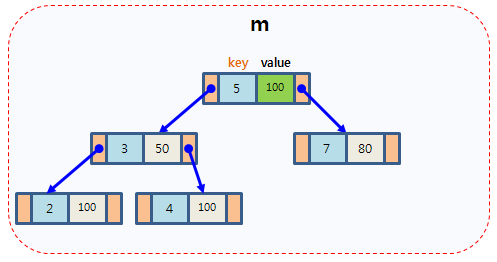

> 迁移来源 [博客园原文](https://www.cnblogs.com/xiuzhublog/p/14149221.html) · 原文发布于 `2020-12-17 13:48:00`（UTC+8）
> 旧文归档，保留当时的记录。

**1，map简介**

map是STL的一个关联容器，它提供一对一的hash。

- 第一个可以称为关键字(key)，每个关键字只能在map中出现一次；
- 第二个可能称为该关键字的值(value)；

map以模板(泛型)方式实现，可以存储任意类型的数据，包括使用者自定义的数据类型。Map主要用于资料一对一映射(one-to-one)的情況，map內部的实现自建一颗红黑树，这颗树具有对数据自动排序的功能。在map内部所有的数据都是有序的，后边我们会见识到有序的好处。比如一个班级中，每个学生的学号跟他的姓名就存在著一对一映射的关系。



**2，map的功能**

自动建立key － value的对应。key 和 value可以是任意你需要的类型，包括自定义类型。

**3，使用map**

使用map得包含map类所在的头文件

#include <map>  //注意，STL头文件没有扩展名.h

map对象是模板类，需要关键字和存储对象两个模板参数：

std:map<**int**, string> personnel;

这样就定义了一个用int作为索引,并拥有相关联的指向string的指针.

为了使用方便，可以对模板类进行一下类型定义，

**typedef**map<**int**,CString> UDT\_MAP\_INT\_CSTRING;

UDT\_MAP\_INT\_CSTRING enumMap;

**4，map的构造函数**

map共提供了6个构造函数，这块涉及到内存分配器这些东西，略过不表，在下面我们将接触到一些map的构造方法，这里要说下的就是，我们通常用如下方法构造一个map：

map<int, string> mapStudent;

**5，插入元素**

```cpp
1. // 定义一个map对象
2. map<int, string> mapStudent;

4. // 第一种 用insert函數插入pair
5. mapStudent.insert(pair<int, string>(000, "student_zero"));

7. // 第二种 用insert函数插入value_type数据
8. mapStudent.insert(map<int, string>::value_type(001, "student_one"));

10. // 第三种 用"array"方式插入
11. mapStudent[123] = "student_first";
12. mapStudent[456] = "student_second";
```

以上三种用法，虽然都可以实现数据的插入，但是它们是有区别的，当然了第一种和第二种在效果上是完成一样的，用insert函数插入数据，在数据的 插入上涉及到集合的唯一性这个概念，即当map中有这个关键字时，insert操作是不能在插入数据的，但是用数组方式就不同了，它可以覆盖以前该关键字对 应的值，用程序说明如下：

```cpp
1. mapStudent.insert(map<int, string>::value_type (001, "student_one"));

3. mapStudent.insert(map<int, string>::value_type (001, "student_two"));
```

上面这两条语句执行后，map中001这个关键字对应的值是“student\_one”，第二条语句并没有生效，那么这就涉及到我们怎么知道insert语句是否插入成功的问题了，可以用pair来获得是否插入成功，程序如下

```cpp
1. // 构造定义，返回一个pair对象
2. pair<iterator,bool> insert (const value_type& val);

4. pair<map<int, string>::iterator, bool> Insert_Pair;

6. Insert_Pair = mapStudent.insert(map<int, string>::value_type (001, "student_one"));

8. if(!Insert_Pair.second)
9. cout << ""Error insert new element" << endl;
```

我们通过pair的第二个变量来知道是否插入成功，它的第一个变量返回的是一个map的迭代器，如果插入成功的话Insert\_Pair.second应该是true的，否则为false。

**6， 查找元素**

当所查找的关键key出现时，它返回数据所在对象的位置，如果沒有，返回iter与end函数的值相同。

```cpp
1. // find 返回迭代器指向当前查找元素的位置否则返回map::end()位置
2. iter = mapStudent.find("123");

4. if(iter != mapStudent.end())
5. cout<<"Find, the value is"<<iter->second<<endl;
6. else
7. cout<<"Do not Find"<<endl;
```

**7， 刪除与清空元素**

```cpp
1. //迭代器刪除
2. iter = mapStudent.find("123");
3. mapStudent.erase(iter);

5. //用关键字刪除
6. int n = mapStudent.erase("123"); //如果刪除了會返回1，否則返回0

8. //用迭代器范围刪除 : 把整个map清空
9. mapStudent.erase(mapStudent.begin(), mapStudent.end());
10. //等同于mapStudent.clear()
```

**8，map的大小**

在往map里面插入了数据，我们怎么知道当前已经插入了多少数据呢，可以用size函数，用法如下：

```cpp
int nSize = mapStudent.size();
```

**9，map的基本操作函数：**

     C++ maps是一种关联式容器，包含“关键字/值”对

**begin**()         返回指向map头部的迭代器

**clear**(）        删除所有元素

**count**()         返回指定元素出现的次数

**empty**()         如果map为空则返回true

**end**()           返回指向map末尾的迭代器

**equal\_range**()   返回特殊条目的迭代器对

**erase**()         删除一个元素

**find**()          查找一个元素

**get\_allocator**() 返回map的配置器

**insert**()        插入元素

**key\_comp**()      返回比较元素key的函数

**lower\_bound**()   返回键值>=给定元素的第一个位置

**max\_size**()      返回可以容纳的最大元素个数

**rbegin**()        返回一个指向map尾部的逆向迭代器

**rend**()          返回一个指向map头部的逆向迭代器

**size**()          返回map中元素的个数

**swap**()           交换两个map

**upper\_bound**()    返回键值>给定元素的第一个位置

**value\_comp**()     返回比较元素value的函数
