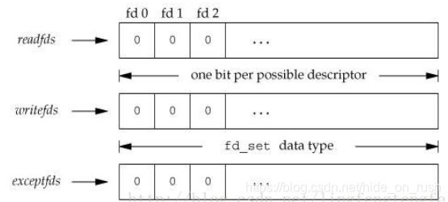

> 迁移来源 [博客园原文](https://www.cnblogs.com/xiuzhublog/p/13533242.html) · 原文发布于 `2020-08-20 09:33:00`（UTC+8）

通过网络查找资料得到的都是一些零碎不成体系的知识点，无法融会贯通。而且需要筛选有用的信息，这需要花费大量的时间。所以把写代码过程中用到的相关知识的博客链接附在用到的位置，方便回顾。

## 1.程序流程

- 服务器端：socker()建立套接字，绑定（bind）并监听（listen），用accept（）等待客户端连接。
- 客户端：socker()建立套接字，连接（connect）服务器，连接上后使用send()和recv（），在套接字上写读数据，直至数据交换完毕，close()关闭套接字。

## 2.实现

具体实现上使用select函数[Linux Select](https://blog.csdn.net/youyou1543724847/article/details/83445226)  
在收发信息的时候，端口是会被占用的，也就是处于阻塞状态。例如这个例子[UDP 组播 实例](https://blog.csdn.net/cjsycyl/article/details/19676737)，只能实现一对一的通信。  
在Linux中，我们可以使用select函数实现I/O端口的复用，传递给 select函数的参数会告诉内核：

- 我们所关心的文件描述符
- 对每个描述符，我们所关心的状态。(我们是要想从一个文件描述符中读或者写，还是关注一个描述符中是否出现异常)
- 我们要等待多长时间。(我们可以等待无限长的时间，等待固定的一段时间，或者根本就不等待)

从 select函数返回后，内核告诉我们一下信息：

- 对我们的要求已经做好准备的描述符的个数
- 对于三种条件哪些描述符已经做好准备.(读，写，异常)

有了这些返回信息，我们可以调用合适的I/O函数(通常是 read 或 write)，并且这些函数不会再阻塞.

#### select函数介绍

select函数原型如下：

```java
int select (int maxfds, fd_set *readfds, fd_set *writefds, fd_set *exceptfds, struct timeval *timeout);
```

select系统调用是用来让我们的程序监视多个文件句柄(socket 句柄)的状态变化的。程序会停在select这里等待，直到被监视的文件句柄有一个或多个发生了状态改变。返回：做好准备的文件描述符的个数，超时为0，错误为 -1.

具体参数的解释

1. intmaxfdp是一个整数值，是指集合中所有文件描述符的范围，即所有文件描述符的最大值加1，不能错。

说明：对于这个原理的解释可以看下边fd\_set的详细解释，fd\_set是以位图的形式来存储这些文件描述符。maxfdp也就是定义了位图中有效的位的个数。

2. fd\_set\*readfds是指向fd\_set结构的指针，这个集合中应该包括文件描述符，我们是要监视这些文件描述符的读变化的，即我们关心是否可以从这些文件中读取数据了，如果这个集合中有一个文件可读，select就会返回一个大于0的值，表示有文件可读；如果没有可读的文件，则根据timeout参数再判断是否超时，若超出timeout的时间，select返回0，若发生错误返回负值。可以传入NULL值，表示不关心任何文件的读变化。
3. fd\_set\*writefds是指向fd\_set结构的指针，这个集合中应该包括文件描述符，我们是要监视这些文件描述符的写变化的，即我们关心是否可以向这些文件中写入数据了，如果这个集合中有一个文件可写，select就会返回一个大于0的值，表示有文件可写，如果没有可写的文件，则根据timeout参数再判断是否超时，若超出timeout的时间，select返回0，若发生错误返回负值。可以传入NULL值，表示不关心任何文件的写变化。
4. fd\_set\*errorfds同上面两个参数的意图，用来监视文件错误异常文件。
5. structtimeval\* timeout是select的超时时间，这个参数至关重要，它可以使select处于三种状态，第一，若将NULL以形参传入，即不传入时间结构，就是将select置于阻塞状态，一定等到监视文件描述符集合中某个文件描述符发生变化为止；第二，若将时间值设为0秒0毫秒，就变成一个纯粹的非阻塞函数，不管文件描述符是否有变化，都立刻返回继续执行，文件无变化返回0，有变化返回一个正值；第三，timeout的值大于0，这就是等待的超时时间，即 select在timeout时间内阻塞，超时时间之内有事件到来就返回了，否则在超时后不管怎样一定返回，返回值同上述。

#### 详细解释

首先我们先看一下最后一个参数。它指明我们要等待的时间：

```cpp
struct timeval{      
        long tv_sec;   /*秒 */
        long tv_usec;  /*微秒 */   
    }
```

tv\_sec 代表多少秒  
tv\_usec 代表多少微秒 1000000 微秒 = 1秒  
有三种情况：

`timeout == NULL` 等待无限长的时间。等待可以被一个信号中断。当有一个描述符做好准备或者是捕获到一个信号时函数会返回。如果捕获到一个信号， select函数将返回 -1,并将变量 erro设为 EINTR。

`timeout->tv_sec == 0 &&timeout->tv_usec == 0`不等待，直接返回。加入描述符集的描述符都会被测试，并且返回满足要求的描述符的个数。这种方法通过轮询，无阻塞地获得了多个文件描述符状态。

`timeout->tv_sec !=0 ||timeout->tv_usec!= 0` 等待指定的时间。当有描述符符合条件或者超过超时时间的话，函数返回。在超时时间即将用完但又没有描述符合条件的话，返回 0。对于第一种情况，等待也会被信号所中断。

中间的三个参数 readset, writset, exceptset,指向描述符集。这些参数指明了我们关心哪些描述符，和需要满足什么条件(可写，可读，异常)。一个文件描述集保存在 fd\_set 类型中。fd\_set类型变量每一位代表了一个描述符。我们也可以认为它只是一个由很多二进制位构成的数组。如下图所示：  
  
[Linux: fd\_set用法](https://blog.csdn.net/bailyzheng/article/details/7477446)  
对于 fd\_set类型的变量我们所能做的就是声明一个变量，为变量赋一个同种类型变量的值，或者使用以下几个宏来控制它：

```cpp
#include <sys/select.h>   
int FD_ZERO(int fd, fd_set *fdset);   
int FD_CLR(int fd, fd_set *fdset);   
int FD_SET(int fd, fd_set *fd_set);   
int FD_ISSET(int fd, fd_set *fdset);
```

FD\_ZERO宏将一个 fd\_set类型变量的所有位都设为 0，使用FD\_SET将变量的某个位置位。清除某个位时可以使用 FD\_CLR，我们可以使用FD\_ISSET来测试某个位是否被置位。

当声明了一个文件描述符集后，必须用FD\_ZERO将所有位置零。之后将我们所感兴趣的描述符所对应的位置位，操作如下：

```cpp
fd_set rset;   
int fd;   
FD_ZERO(&rset);   
FD_SET(fd, &rset);   
FD_SET(stdin, &rset);
```

select返回后，用FD\_ISSET测试给定位是否置位：

```cpp
if(FD_ISSET(fd, &rset)   
 
{ ... }
```

#### 关于select模型

理解select模型的关键在于理解fd\_set,为说明方便，取fd\_set长度为1字节，fd\_set中的每一bit可以对应一个文件描述符fd。则1字节长的fd\_set最大可以对应8个fd。

（1）执行fd\_set set;FD\_ZERO(&set);则set用位表示是0000,0000。

（2）若fd＝5,执行FD\_SET(fd,&set);后set变为0001,0000(第5位置为1)

（3）若再加入fd＝2，fd=1,则set变为0001,0011

（4）执行select(6,&set,0,0,0)阻塞等待

（5）若fd=1,fd=2上都发生可读事件，则select返回，此时set变为0000,0011。**注意：没有事件发生的fd=5被清空**。

基于上面的讨论，可以轻松得出select模型的特点：

（1)可监控的文件描述符个数取决与sizeof(fd\_set)的值。我这边服务器上sizeof(fd\_set)＝512，每bit表示一个文件描述符，则我服务器上支持的最大文件描述符是512\*8=4096。据说可调，另有说虽然可调，但调整上限受于编译内核时的变量值。

（2）将fd加入select监控集的同时，还要再使用一个数据结构array保存放到select监控集中的fd，一是用于再select返回后，array作为源数据和fd\_set进行FD\_ISSET判断。二是select返回后会把以前加入的但并无事件发生的fd清空，则每次开始 select前都要重新从array取得fd逐一加入（FD\_ZERO最先），扫描array的同时取得fd最大值maxfd，用于select的第一个参数。

（3）可见select模型必须在select前循环array（加fd，取maxfd），select返回后循环array（FD\_ISSET判断是否有时间发生）。

这种实现方式是有缺点的，一是能监听的端口数量有限，二是采用轮询的方法当套接字多了以后效率很低。三是需要有一个存储大量fd的数据结构，用户空间和内核空间在传递该结构时复制开销大

关于上面所说的I/O，select相关的问题这篇博客说的很明白[Linux Select](https://blog.csdn.net/youyou1543724847/article/details/83445226)  
[网络字节转换inet\_aton、inet\_nota、inet\_addr](https://blog.csdn.net/u010439954/article/details/45849281?locationNum=9&fps=1)  
[C++基础--htons(),htonl(),ntohs(),ntohl()](https://www.cnblogs.com/kingdom_0/articles/2572078.html)

## 3.实现代码

[Socket原理及实践（Java/C/C++)](/posts/socket-fundamentals-java-c-cpp/)  
[sockaddr详解](https://blog.csdn.net/jack237/article/details/7441607)  
[C语言网络编程：bind函数详解](https://blog.csdn.net/Z_Stand/article/details/102533220?utm_medium=distribute.pc_relevant.none-task-blog-OPENSEARCH-3.channel_param&depth_1-utm_source=distribute.pc_relevant.none-task-blog-OPENSEARCH-3.channel_param)  
[c++ Socket学习——使用listen(),accept(),write(),read()函数](https://blog.csdn.net/linglongbayinhe/article/details/84066068)  
[STDIN\_FILENO](https://blog.csdn.net/youyou1543724847/article/details/83445226)  
[C语言文件操作之fgets（）](https://blog.csdn.net/daiyutage/article/details/8540932?utm_medium=distribute.pc_relevant.none-task-blog-BlogCommendFromMachineLearnPai2-3.channel_param&depth_1-utm_source=distribute.pc_relevant.none-task-blog-BlogCommendFromMachineLearnPai2-3.channel_param)因为gets()的不安全，所以使用fgets（）代替  
[socklen\_t 类型](https://blog.csdn.net/gszhy/article/details/9307179)  
[socket编程之accept()函数](https://www.cnblogs.com/java20130726/archive/2011/12/20/3218630.html)

### 服务器端：

```cpp
#include<stdio.h>  
#include<stdlib.h>  
#include<netinet/in.h>  
#include<sys/socket.h>  
#include<arpa/inet.h>  
#include<string.h>  
#include<unistd.h>  
#define BACKLOG 5     //完成三次握手但没有accept的队列的长度  
#define CONCURRENT_MAX 8   //应用层同时可以处理的连接  
#define SERVER_PORT 11332  
#define BUFFER_SIZE 1024  
#define QUIT_CMD ".quit"  
int client_fds[CONCURRENT_MAX];  //声明一个数组来存储状态
int main(int argc, const char * argv[])  
{  
    char input_msg[BUFFER_SIZE];  //限定最大值
    char recv_msg[BUFFER_SIZE];    
    struct sockaddr_in server_addr;  
    server_addr.sin_family = AF_INET;  
    server_addr.sin_port = htons(SERVER_PORT);  
    server_addr.sin_addr.s_addr = inet_addr("127.0.0.1");  
    bzero(&(server_addr.sin_zero), 8);  
    //创建socket  
    int server_sock_fd = socket(AF_INET, SOCK_STREAM, 0);  
    if(server_sock_fd == -1)  
    {  
        perror("socket error");  
        return 1;  
    }  
    //绑定socket  
    int bind_result = bind(server_sock_fd, (struct sockaddr *)&server_addr, sizeof(server_addr));  
    if(bind_result == -1)  
    {  
        perror("bind error");  
        return 1;  
    }  
    //listen  
    if(listen(server_sock_fd, BACKLOG) == -1)  
    {  
        perror("listen error");  
        return 1;  
    }  
    //fd_set  
    fd_set server_fd_set;  /*fd_set实际上是一long类型的数组，每一个数组元素都能与一打开的文件句柄 (不管是socket句柄，还是其他文件或命名管道或设备句柄) 建立联系，建立联系的工作由程序员完成，当调用select()时，由内核根据IO状态修改fe_set的内容，由此来通知执行了select()的进程哪一socket或文件可读。*/
    int max_fd = -1;  
    struct timeval tv;  //超时时间设置  
    while(1)  
    {  
        tv.tv_sec = 20;  
        tv.tv_usec = 0;  
        FD_ZERO(&server_fd_set);  
        FD_SET(STDIN_FILENO, &server_fd_set);  
        if(max_fd <STDIN_FILENO)  //STDIN_FILENO 标准输入设备的文件描述符（键盘）
        {  
            max_fd = STDIN_FILENO;  
        }  
        //printf("STDIN_FILENO=%d\n", STDIN_FILENO);  
    //服务器端socket  
        FD_SET(server_sock_fd, &server_fd_set);  
       // printf("server_sock_fd=%d\n", server_sock_fd);  
        if(max_fd < server_sock_fd)  
        {  
            max_fd = server_sock_fd;  
        }  
    //客户端连接  
        for(int i =0; i < CONCURRENT_MAX; i++)  
        {  
            //printf("client_fds[%d]=%d\n", i, client_fds[i]);  
            if(client_fds[i] != 0)  
            {  
                FD_SET(client_fds[i], &server_fd_set);  
                if(max_fd < client_fds[i])  
                {  
                    max_fd = client_fds[i];  
                }  
            }  
        }  
        int ret = select(max_fd + 1, &server_fd_set, NULL, NULL, &tv);  
        if(ret < 0)  
        {  
            perror("select 出错\n");  
            continue;  
        }  
        else if(ret == 0)  
        {  
            printf("select 超时\n");  
            continue;  
        }  
        else  
        {  
            //ret 为未状态发生变化的文件描述符的个数  
            if(FD_ISSET(STDIN_FILENO, &server_fd_set))  
            {  
                printf("发送消息：\n");  
                bzero(input_msg, BUFFER_SIZE);  
                fgets(input_msg, BUFFER_SIZE, stdin);  
                //输入“.quit"则退出服务器  
                if(strcmp(input_msg, QUIT_CMD) == 0)  
                {  
                    exit(0);  
                }  
                for(int i = 0; i < CONCURRENT_MAX; i++)  
                {  
                    if(client_fds[i] != 0)  
                    {  
                        printf("client_fds[%d]=%d\n", i, client_fds[i]);  
                        send(client_fds[i], input_msg, BUFFER_SIZE, 0);  
                    }  
                }  
            }  
            if(FD_ISSET(server_sock_fd, &server_fd_set))  
            {  
                //有新的连接请求  
                struct sockaddr_in client_address;  
                socklen_t address_len;  
                int client_sock_fd = accept(server_sock_fd, (struct sockaddr *)&client_address, &address_len);  
                printf("new connection client_sock_fd = %d\n", client_sock_fd);  
                if(client_sock_fd > 0)  
                {  
                    int index = -1;  
                    for(int i = 0; i < CONCURRENT_MAX; i++)  
                    {  
                        if(client_fds[i] == 0)  
                        {  
                            index = i;  
                            client_fds[i] = client_sock_fd;  
                            break;  
                        }  
                    }  
                    if(index >= 0)  
                    {  
                        printf("新客户端(%d)加入成功 %s:%d\n", index, inet_ntoa(client_address.sin_addr), ntohs(client_address.sin_port));  
                    }  
                    else  
                    {  
                        bzero(input_msg, BUFFER_SIZE);  
                        strcpy(input_msg, "服务器加入的客户端数达到最大值,无法加入!\n");  
                        send(client_sock_fd, input_msg, BUFFER_SIZE, 0);  
                        printf("客户端连接数达到最大值，新客户端加入失败 %s:%d\n", inet_ntoa(client_address.sin_addr), ntohs(client_address.sin_port));  
                    }  
                }  
            }  
            for(int i =0; i < CONCURRENT_MAX; i++)  
            {  
                if(client_fds[i] !=0)  
                {  
                    if(FD_ISSET(client_fds[i], &server_fd_set))  
                    {  
                        //处理某个客户端过来的消息  
                        bzero(recv_msg, BUFFER_SIZE);  
                        long byte_num = recv(client_fds[i], recv_msg, BUFFER_SIZE, 0);  
                        if (byte_num > 0)  
                        {  
                            if(byte_num > BUFFER_SIZE)  
                            {  
                                byte_num = BUFFER_SIZE;  
                            }  
                            recv_msg[byte_num] = '\0';  
                            printf("客户端(%d):%s\n", i, recv_msg);  
                        }  
                        else if(byte_num < 0)  
                        {  
                            printf("从客户端(%d)接受消息出错.\n", i);  
                        }  
                        else  
                        {  
                            FD_CLR(client_fds[i], &server_fd_set);  
                            client_fds[i] = 0;  
                            printf("客户端(%d)退出了\n", i);  
                        }  
                    }  
                }  
            }  
        }  
    }  
    return 0;  
}
```

### 客户端

[connect函数详解](https://blog.csdn.net/stpeace/article/details/13614591)  
[Linux下Socket网络编程send和recv使用注意事项](https://blog.csdn.net/K346K346/article/details/48735595?utm_medium=distribute.pc_relevant.none-task-blog-BlogCommendFromMachineLearnPai2-1.channel_param&depth_1-utm_source=distribute.pc_relevant.none-task-blog-BlogCommendFromMachineLearnPai2-1.channel_param)

```cpp
#include<stdio.h>  
#include<stdlib.h>  
#include<netinet/in.h>  
#include<sys/socket.h>  
#include<arpa/inet.h>  
#include<string.h>  
#include<unistd.h>  
#define BUFFER_SIZE 1024  
  
int main(int argc, const char * argv[])  
{  
    struct sockaddr_in server_addr;  
    server_addr.sin_family = AF_INET;  
    server_addr.sin_port = htons(11332);  
    server_addr.sin_addr.s_addr = inet_addr("127.0.0.1");  
    bzero(&(server_addr.sin_zero), 8);  
  
    int server_sock_fd = socket(AF_INET, SOCK_STREAM, 0);  
    if(server_sock_fd == -1)  
    {  
    perror("socket error");  
    return 1;  
    }  
    char recv_msg[BUFFER_SIZE];  
    char input_msg[BUFFER_SIZE];  
  
    if(connect(server_sock_fd, (struct sockaddr *)&server_addr, sizeof(struct sockaddr_in)) == 0)  
    {  
    fd_set client_fd_set;  
    struct timeval tv;  
  
    while(1)  
    {  
        tv.tv_sec = 20;  
        tv.tv_usec = 0;  
        FD_ZERO(&client_fd_set);  
        FD_SET(STDIN_FILENO, &client_fd_set);  
        FD_SET(server_sock_fd, &client_fd_set);  
  
       select(server_sock_fd + 1, &client_fd_set, NULL, NULL, &tv);  
        if(FD_ISSET(STDIN_FILENO, &client_fd_set))  
        {  
            bzero(input_msg, BUFFER_SIZE);  
            fgets(input_msg, BUFFER_SIZE, stdin);  
            if(send(server_sock_fd, input_msg, BUFFER_SIZE, 0) == -1)  
            {  
                perror("发送消息出错!\n");  
            }  
        }  
        if(FD_ISSET(server_sock_fd, &client_fd_set))  
        {  
            bzero(recv_msg, BUFFER_SIZE);  
            long byte_num = recv(server_sock_fd, recv_msg, BUFFER_SIZE, 0);  
            if(byte_num > 0)  
            {  
            if(byte_num > BUFFER_SIZE)  
            {  
                byte_num = BUFFER_SIZE;  
            }  
            recv_msg[byte_num] = '\0';  
            printf("服务器:%s\n", recv_msg);  
            }  
            else if(byte_num < 0)  
            {  
            printf("接受消息出错!\n");  
            }  
            else  
            {  
            printf("服务器端退出!\n");  
            exit(0);  
            }  
        }  
        }  
    //}  
    }  
    return 0;  
}
```
