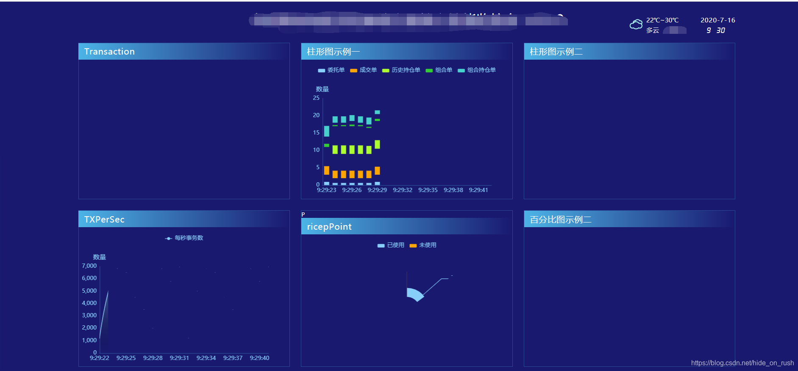
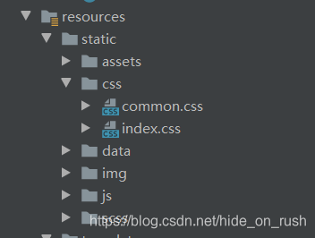
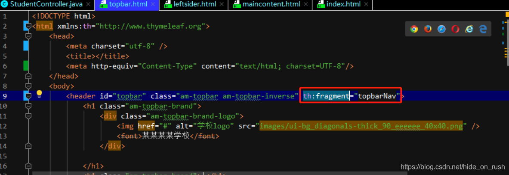

> 迁移来源 [CSDN原文](https://blog.csdn.net/hide_on_rush/article/details/107375952) · 原文发布于 `2020-07-16 10:00:59`（UTC+8）
> 正文取自 [博客园同期版本](https://www.cnblogs.com/xiuzhublog/p/13321095.html)。

初学SpringBoot，写项目的时候遇到了问题，原本的页面是这样的  
  
但启动项目后是这样的  
  
这是因为thymeleaf中引入静态资源及模板需要使用到 th:xxx 属性，否则无法在动态资源中访问静态资源。  
记录一下解决方案。

## 访问css

需要用到 th:href 来引入css资源，格式为 th:href = “@{文件路径}”  
如

```java
<link rel="stylesheet" href="css/jquery-ui.min.css" th:href="@{/css/jquery-ui.min.css}" />
```

## 访问js

需要用到 th:src 来引入js资源，格式为 th:src = “@{文件路径}”  
如

```java
<script src="js/jquery.js" th:src="@{/js/jquery.js}"></script>
```

这里如果项目结构是这样：  
  
那么写法上不需要像静态页面那样引入  


## include页面

当要把页面拆分为模板，使用include方式（html中为jquary.load方式）引入时，需要使用  
th:include=“要引入的html文件名::html中th:fragment属性中的值”

```java
<div id="pageTop" >
   <header class="am-topbar am-topbar-inverse" th:include="topbar::topbarNav"></header>
</div>
<div class="super-bar">
   <div id="pageLeft"  >
      <div class="left-sidebar" th:include="leftsider::leftSiderNav"></div>
   </div>
   <div id="pageMain"  >
      <div class="main-content" th:include="maincontent::mainContentNav"></div>
   </div>
</div>
```

如th:include=“topbar::topbarNav”，即引用了topbar.html页面的某个标签  
  
注意！！！如上图，topbar.html使用了th:fragment标签引入到index.html页面后，它的class属性不会随着过去（但它的子元素的不会受到影响），需要在index所引用的位置添加相应的class
