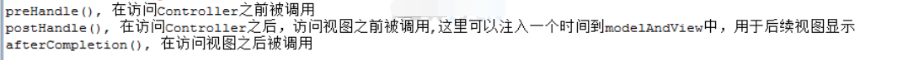

> 迁移来源 [博客园原文](https://www.cnblogs.com/xiuzhublog/p/12919417.html) · 原文发布于 `2020-05-19 21:20:00`（UTC+8）
> 旧文归档，文中的依赖和运行环境以当年版本为准。

这个是基于之前的视图定位进行的。

## 拦截器类：IndexInterceptor

```java
package interceptor;
import java.util.Date;
 
import javax.servlet.http.HttpServletRequest;
import javax.servlet.http.HttpServletResponse;
 
import org.springframework.web.servlet.ModelAndView;
import org.springframework.web.servlet.handler.HandlerInterceptorAdapter;
 
public class IndexInterceptor extends HandlerInterceptorAdapter { 
 
     /** 
     * 在业务处理器处理请求之前被调用 
     * 如果返回false 
     *     从当前的拦截器往回执行所有拦截器的afterCompletion(),再退出拦截器链
     * 如果返回true 
     *    执行下一个拦截器,直到所有的拦截器都执行完毕 
     *    再执行被拦截的Controller 
     *    然后进入拦截器链, 
     *    从最后一个拦截器往回执行所有的postHandle() 
     *    接着再从最后一个拦截器往回执行所有的afterCompletion() 
     */   
    public boolean preHandle(HttpServletRequest request,   
            HttpServletResponse response, Object handler) throws Exception {
         
        System.out.println("preHandle(), 在访问Controller之前被调用"); 
        return true;
         
    } 
 
    /**
     * 在业务处理器处理请求执行完成后,生成视图之前执行的动作   
     * 可在modelAndView中加入数据，比如当前时间
     */ 
     
    public void postHandle(HttpServletRequest request,   
            HttpServletResponse response, Object handler,   
            ModelAndView modelAndView) throws Exception { 
        System.out.println("postHandle(), 在访问Controller之后，访问视图之前被调用,这里可以注入一个时间到modelAndView中，用于后续视图显示");
        modelAndView.addObject("date","由拦截器生成的时间:" + new Date());
    } 
 
    /** 
     * 在DispatcherServlet完全处理完请求后被调用,可用于清理资源等  
     *  
     * 当有拦截器抛出异常时,会从当前拦截器往回执行所有的拦截器的afterCompletion() 
     */
     
    public void afterCompletion(HttpServletRequest request,   
            HttpServletResponse response, Object handler, Exception ex) 
    throws Exception { 
           
        System.out.println("afterCompletion(), 在访问视图之后被调用"); 
    } 
       
}
```

## 配置拦截器

修改springmvc-servlet.xml以对/index路径进行拦截

如果要拦截其他路径：  
/\*\* 拦截所有  
/category/\*\* 拦截/category路径下的所有

```java
<?xml version="1.0" encoding="UTF-8"?>
<beans xmlns="http://www.springframework.org/schema/beans" 
    xmlns:xsi="http://www.w3.org/2001/XMLSchema-instance" xmlns:context="http://www.springframework.org/schema/context" 
    xmlns:mvc="http://www.springframework.org/schema/mvc" 
    xsi:schemaLocation="http://www.springframework.org/schema/beans 
     http://www.springframework.org/schema/beans/spring-beans-3.0.xsd 
     http://www.springframework.org/schema/context 
     http://www.springframework.org/schema/context/spring-context-3.0.xsd 
     http://www.springframework.org/schema/mvc 
     http://www.springframework.org/schema/mvc/spring-mvc-3.0.xsd">
    <bean id="viewResolver"
        class="org.springframework.web.servlet.view.InternalResourceViewResolver">
        <property name="prefix" value="/WEB-INF/page/" />
        <property name="suffix" value=".jsp" />
    </bean>
 
    <bean id="simpleUrlHandlerMapping"
        class="org.springframework.web.servlet.handler.SimpleUrlHandlerMapping">
        <property name="mappings">
            <props>
                <prop key="/index">indexController</prop>
            </props>
        </property>
    </bean>
    <bean id="indexController" class="controller.IndexController"></bean>
    <mvc:interceptors>   
        <mvc:interceptor>   
            <mvc:mapping path="/index"/> 
            <!-- 定义在mvc:interceptor下面的表示是对特定的请求才进行拦截的 --> 
            <bean class="interceptor.IndexInterceptor"/>     
        </mvc:interceptor> 
        <!-- 当设置多个拦截器时，先按顺序调用preHandle方法，然后逆序调用每个拦截器的postHandle和afterCompletion方法 --> 
    </mvc:interceptors>
         
</beans>
```

## 修改 index.jsp

```java
<%@ page language="java" contentType="text/html; charset=UTF-8"
    pageEncoding="UTF-8" isELIgnored="false"%>
 
<h1>${message}</h1>
 
<p>${date}</p>
```

## 效果


