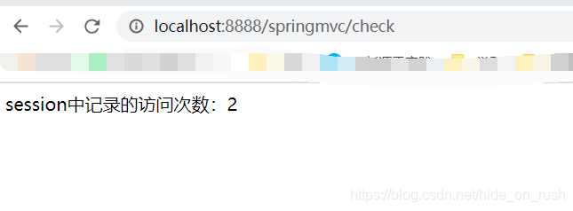

> 迁移来源 [博客园原文](https://www.cnblogs.com/xiuzhublog/p/12918816.html) · 原文发布于 `2020-05-19 18:56:00`（UTC+8）
> 旧文归档，文中的依赖和运行环境以当年版本为准。

Session在用户登录，一些特殊场合在页面间传递数据的时候会经常用到

## 修改IndexController

映射 /check 到方法check()  
为方法check()提供参数HttpSession session，这样就可以在方法体中使用session了  
接下来的逻辑就是每次访问为session中的count+1.  
最后跳转到check.jsp页面

```java
package controller;
 
import javax.servlet.http.HttpServletRequest;
import javax.servlet.http.HttpServletResponse;
import javax.servlet.http.HttpSession;
 
import org.springframework.stereotype.Controller;
import org.springframework.web.bind.annotation.RequestMapping;
import org.springframework.web.servlet.ModelAndView;
 
@Controller
public class IndexController {
    @RequestMapping("/index")
    public ModelAndView handleRequest(HttpServletRequest request, HttpServletResponse response) throws Exception {
        ModelAndView mav = new ModelAndView("index");
        mav.addObject("message", "Hello Spring MVC");
        return mav;
    }
 
    @RequestMapping("/jump")
    public ModelAndView jump() {
        ModelAndView mav = new ModelAndView("redirect:/index");
        return mav;
    }
 
    @RequestMapping("/check")
    public ModelAndView check(HttpSession session) {
        Integer i = (Integer) session.getAttribute("count");
        if (i == null)
            i = 0;
        i++;
        session.setAttribute("count", i);
        ModelAndView mav = new ModelAndView("check");
        return mav;
    }
 
}
```

## check.jsp

```java
<%@ page language="java" contentType="text/html; charset=UTF-8"
    pageEncoding="UTF-8" isELIgnored="false"%>
 
session中记录的访问次数：${count}
```

## 效果


