> 迁移来源 [博客园原文](https://www.cnblogs.com/xiuzhublog/p/12930890.html) · 原文发布于 `2020-05-21 15:23:00`（UTC+8）
> 旧文归档，文中的依赖和运行环境以当年版本为准。

使用SSM框架搭建的简易文章管理系统，实现了简单的增删改查功能。

## 开发工具版本：

- IntelliJ IDEA Ultimate 2019.3.1
- Apache-tomcat-9.0.24
- JDK 1.8.0\_201
- MySQL 8.011
- Maven 3.6.3

## 最终的项目结构

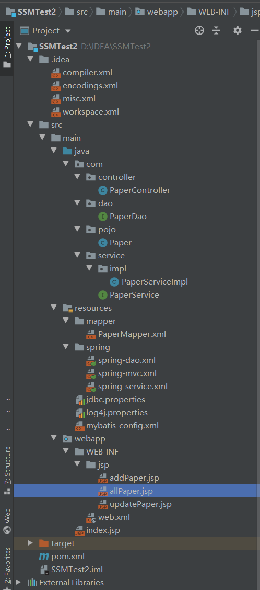

接下来是具体的步骤：

## IDEA+Maven搭建项目骨架

### 1. 新建Maven项目：

过程：File -> New -> Project -> Maven -> 勾选 Create from archetype -> 选择 maven-archetype-webapp(注意：此处不要错选成上面的cocoom-22-archetype-webapp。第一次弄的时候只找webapp很容易选错。。。)  
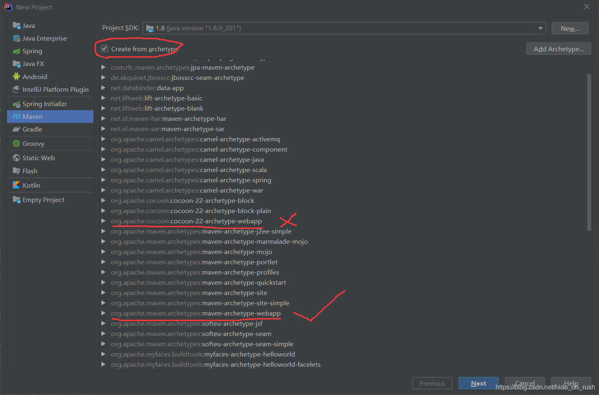  
点击next。在弹出的new project 选项卡中填写项目名称和项目地址，填写GroupId和Artifactid，其中GroupID是项目组织唯一的标识符，实际对应JAVA的包的结构，是main目录里java的目录结构，ArtifactID是项目的唯一的标识符，实际对应项目的名称，就是项目根目录的名称。对于入门练习，这两项可以随意填写。  
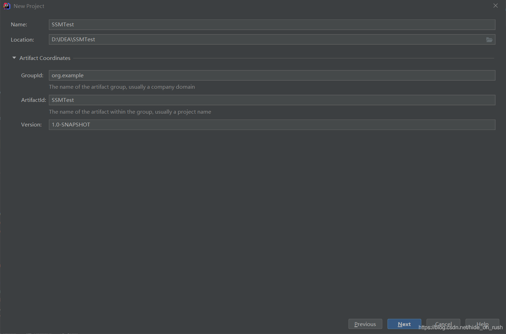  
之后点击next 选择Maven版本（其中IDEA 专业版自带Maven，也可以选择自己下载的maven）。完成后点击Finish，完成项目骨架的创建。**idea自带的Maven3默认位置在C盘。会占用C盘空间，而且如果重装系统的话，配置会丢失，所以我在别的盘另外装了一个。[更改默认位置的方法](https://blog.csdn.net/qq_27093465/article/details/52957253?utm_medium=distribute.pc_relevant.none-task-blog-BlogCommendFromMachineLearnPai2-1.nonecase&depth_1-utm_source=distribute.pc_relevant.none-task-blog-BlogCommendFromMachineLearnPai2-1.nonecase)**

### 2. 在新建的项目中添加所需要的文件/文件夹

创建后的项目如图所示：  
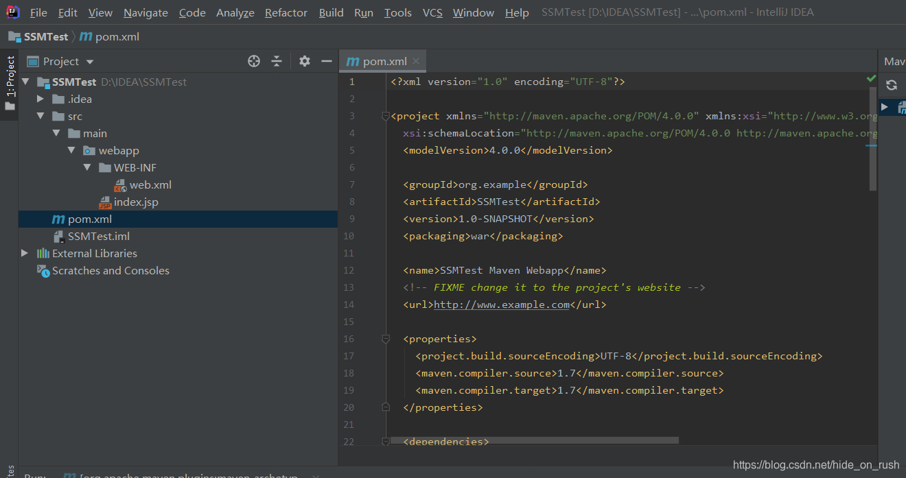

#### 1.

IntelliJ IDEA默认创建maven项目时是没有resource文件夹的，所以需要创建。[方法](https://blog.csdn.net/khxu666/article/details/79851070?utm_medium=distribute.pc_relevant.none-task-blog-BlogCommendFromMachineLearnPai2-1.nonecase&depth_1-utm_source=distribute.pc_relevant.none-task-blog-BlogCommendFromMachineLearnPai2-1.nonecase)（这里用的评论里的方法，比较快）  
接下来我们需要在这之上新建一些目录。在项目的根目录下新建target文件夹，系统自动将其设置为“Excluded”  
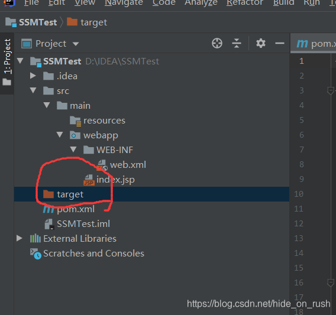

#### 2.

在src/main目录下新建Directory：“java”，会自动将其设置为“Source Root”（即：此项目默认的代码文件源目录）  
老版本手动设置的方法：  
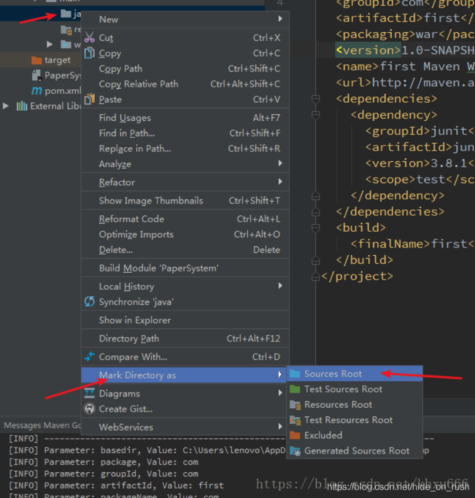

#### 3.

在刚才新建的java文件下新建“com”包，再在com包下新建四个包，分别命名为：pojo,service,dao,controller。  
上面新建的四个包：pojo,service,dao,controller，其所存放的分别是：

- pojo:存放自定义的java类。如：paper类，user类，book类等，每个类的属性设为private，并提供public属性的getter/setter方法让外界访问
- service：定义接口，包含系统所提供的功能。
- dao：定义接口，包含与数据库进行交互的功能。
- controller：控制器，负责接收页面请求，转发和处理。

#### 4.

在resource包下新建Directory：“mapper”（用于存放xxxMapper.xml文件）和“spring”（用于存放spring-xxx.xml配置文件），新建文件：“jdbc.properties”（mysql数据库配置文件）,”log4j.properties”（日志输出配置文件）,”mybatis-config.xml”（mybatis框架配置文件）。

#### 5.

在web-inf目录下新建“jsp”文件夹，存放xxx.jsp显示界面。  
补充之后的项目目录如下图所示，至此项目骨架搭建完毕，开始写代码实现增删改查功能。

### 3.写代码

#### 1.配置pom.xml文件

首先需要对pom.xml文件进行配置，在此文件中配置项目所需要的jar包。  
pom.xml

#### 2.数据库建表

建库使用了Navicat。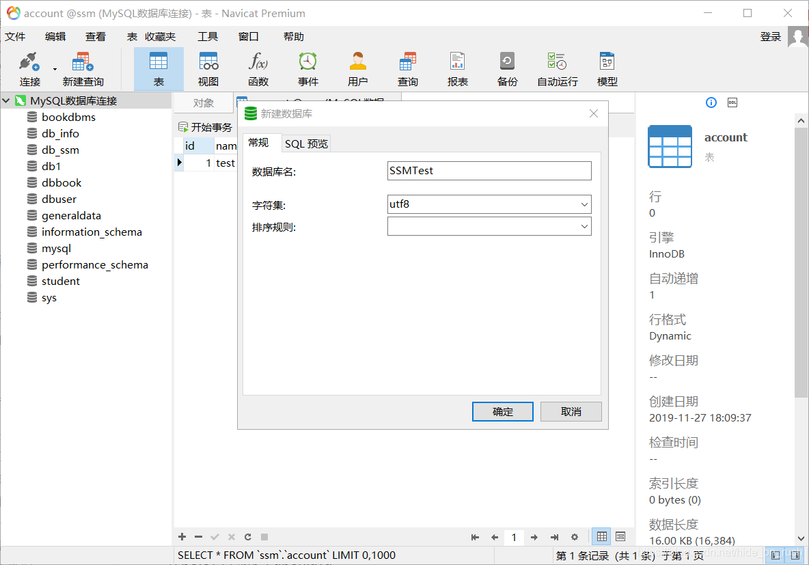  
这个工具挺方便的，但是一直用可视化界面操作。SQL语句好多都忘了。  
下面是建表的SQL语句：

```sql
SET FOREIGN_KEY_CHECKS=0;

-- ----------------------------
-- Table structure for `paper`
-- ----------------------------
DROP TABLE IF EXISTS `paper`;
CREATE TABLE `paper` (
  `paper_id` bigint(20) NOT NULL AUTO_INCREMENT COMMENT 'paperID',
  `name` varchar(100) NOT NULL COMMENT 'paper名称',
  `number` int(11) NOT NULL COMMENT 'paper数量',
  `detail` varchar(200) NOT NULL COMMENT 'paper描述',
  PRIMARY KEY (`paper_id`)
) ENGINE=InnoDB AUTO_INCREMENT=12 DEFAULT CHARSET=utf8 COMMENT='paper表';

-- ----------------------------
-- Records of paper
-- ----------------------------
INSERT INTO `paper` VALUES ('1', '机器学习', '2', 'mlmlmlml');
INSERT INTO `paper` VALUES ('2', '深度学习', '3', 'dldldl');
INSERT INTO `paper` VALUES ('3', '大数据', '4', 'bdbdbd');
```

创建出来是这样的  
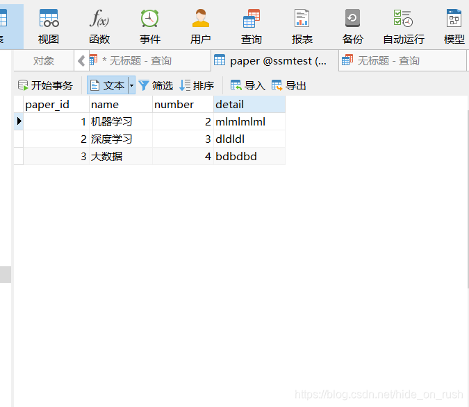

#### 3.写java代码

1. 在pojo包中新建Paper.java

```java
package com.pojo;

public class Paper {
    private long paperId;
    private String paperName;
    private int paperNum;
    private String paperDetail;

    public long getPaperId() {
        return paperId;
    }

    public void setPaperId(long paperId) {
        this.paperId = paperId;
    }

    public String getPaperName() {
        return paperName;
    }

    public void setPaperName(String paperName) {
        this.paperName = paperName;
    }

    public int getPaperNum() {
        return paperNum;
    }

    public void setPaperNum(int paperNum) {
        this.paperNum = paperNum;
    }

    public String getPaperDetail() {
        return paperDetail;
    }

    public void setPaperDetail(String paperDetail) {
        this.paperDetail = paperDetail;
    }

}
```

其中getter/setter方法可以在定义完私有属性之后使用IDEA提供的快捷键：ALT+Insert 来实现快速添加  
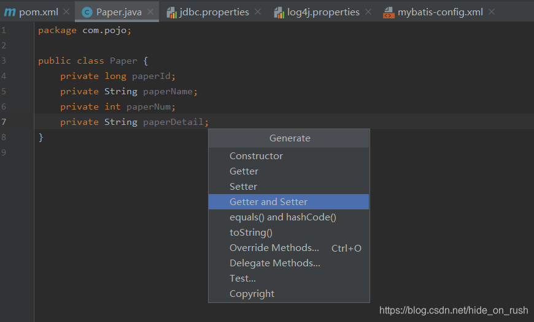  
2. 在service包中新建接口 PaperService：

```java
package com.service;

import com.pojo.Paper;

import java.util.List;

public interface PaperService {
    int addPaper(Paper paper);

    int deletePaperById(long id);

    int updatePaper(Paper paper);

    Paper queryById(long id);

    List<Paper> queryAllPaper();
}
```

3. 在service包下新建impl包，并在此包中新建PaperServiceImpl.java

```java
package com.service.impl;

import com.pojo.Paper;
import com.dao.PaperDao;
import com.service.PaperService;

import org.springframework.beans.factory.annotation.Autowired;
import org.springframework.stereotype.Service;

import java.util.List;

@Service
public class PaperServiceImpl implements PaperService {
    @Autowired
    private PaperDao paperDao;

    @Override
    public int addPaper(Paper paper) {
        return paperDao.addPaper(paper);
    }

    @Override
    public int deletePaperById(long id) {
        return paperDao.deletePaperById(id);
    }

    @Override
    public int updatePaper(Paper paper) {
        return paperDao.updatePaper(paper);
    }

    @Override
    public Paper queryById(long id) {
        return paperDao.queryById(id);
    }

    @Override
    public List<Paper> queryAllPaper() {
        return paperDao.queryAllPaper();
    }

}
```

4. 在dao包中新建接口 PaperDao.java

```java
package com.dao;

import com.pojo.Paper;

import java.util.List;

public interface PaperDao {
    int addPaper(Paper paper);

    int deletePaperById(long id);

    int updatePaper(Paper paper);

    Paper queryById(long id);

    List<Paper> queryAllPaper();


}
```

5. 在controller包中新建 PaperController.java

```java
package com.controller;

import com.pojo.Paper;
import com.service.PaperService;

import java.util.List;

import org.springframework.beans.factory.annotation.Autowired;
import org.springframework.stereotype.Controller;
import org.springframework.ui.Model;
import org.springframework.web.bind.annotation.PathVariable;
import org.springframework.web.bind.annotation.RequestMapping;

@Controller
@RequestMapping("/paper")
public class PaperController {
    @Autowired
    private PaperService paperService;

    @RequestMapping("/allPaper")
    public String list(Model model) {
        List<Paper> list = paperService.queryAllPaper();
        model.addAttribute("list", list);
        return "allPaper";
    }

    @RequestMapping("toAddPaper")
    public String toAddPaper() {
        return "addPaper";
    }

    @RequestMapping("/addPaper")
    public String addPaper(Paper paper) {
        paperService.addPaper(paper);
        return "redirect:/paper/allPaper";
    }

    @RequestMapping("/del/{paperId}")
    public String deletePaper(@PathVariable("paperId") Long id) {
        paperService.deletePaperById(id);
        return "redirect:/paper/allPaper";
    }

    @RequestMapping("toUpdatePaper")
    public String toUpdatePaper(Model model, Long id) {
        model.addAttribute("paper", paperService.queryById(id));
        return "updatePaper";
    }

    @RequestMapping("/updatePaper")
    public String updatePaper(Model model, Paper paper) {
        paperService.updatePaper(paper);
        paper = paperService.queryById(paper.getPaperId());
        model.addAttribute("paper", paper);
        return "redirect:/paper/allPaper";
    }
}
```

6. 在resource/mapper包下新建 PaperMapper.xml（mybatis框架mapper代理开发配置文件）

```java
<?xml version="1.0" encoding="UTF-8" ?>
<!DOCTYPE mapper
        PUBLIC "-//mybatis.org//DTD Mapper 3.0//EN"
        "http://mybatis.org/dtd/mybatis-3-mapper.dtd">
<mapper namespace="com.dao.PaperDao">
    <resultMap type="Paper" id="paperResultMap" >
        <id property="paperId" column="paper_id"/>
        <result property="paperName" column="name"/>
        <result property="paperNum" column="number"/>
        <result property="paperDetail" column="detail"/>
    </resultMap>
    <insert id="addPaper" parameterType="Paper">
        INSERT INTO paper(paper_id,name,number,detail) VALUE (#{paperId},#{paperName}, #{paperNum}, #{paperDetail})
    </insert>

    <delete id="deletePaperById" parameterType="long">
        DELETE FROM paper WHERE paper_id=#{paperID}
    </delete>

    <update id="updatePaper" parameterType="Paper">
        UPDATE paper
        SET NAME = #{paperName},NUMBER = #{paperNum},detail = #{paperDetail}
        WHERE  paper_id = #{paperId}
    </update>

    <select id="queryById" resultType="Paper" parameterType="long">
        SELECT paper_id,name,number,detail
        FROM paper
        WHERE paper_id=#{paperId}
    </select>
    <select id="queryAllPaper" resultMap="paperResultMap">
        SELECT paper_id,name,number,detail
        FROM paper
    </select>

</mapper>
```

7. 在resource/spring包下分别新建配置文件：spring-dao.xml , spring-mvc.xml , spring-service.xml。  
   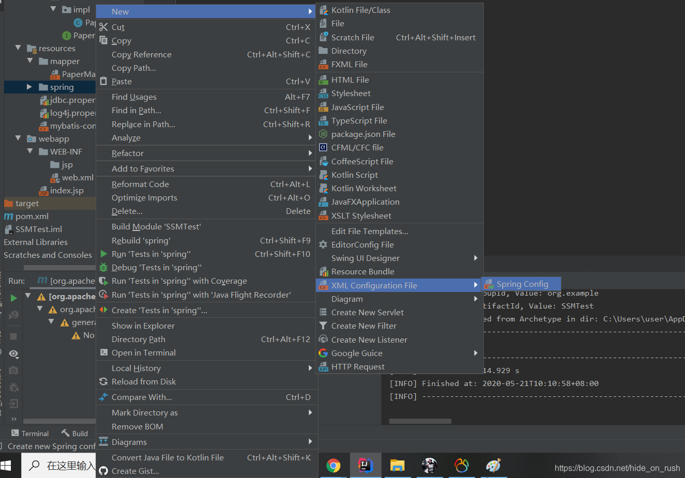  
   spring-dao.xml：（spring-mybatis整合配置文件）

```java
<?xml version="1.0" encoding="UTF-8" ?>
<beans xmlns="http://www.springframework.org/schema/beans"
       xmlns:xsi="http://www.w3.org/2001/XMLSchema-instance"
       xmlns:context="http://www.springframework.org/schema/context"
       xsi:schemaLocation="http://www.springframework.org/schema/beans
    http://www.springframework.org/schema/beans/spring-beans.xsd
    http://www.springframework.org/schema/context
    http://www.springframework.org/schema/context/spring-context.xsd">
    <!-- 配置整合mybatis过程 -->
    <!-- 1.配置数据库相关参数properties的属性：${url} -->
    <context:property-placeholder location="classpath:jdbc.properties"/>

    <!-- 2.数据库连接池 -->
    <bean id="dataSource" class="com.mchange.v2.c3p0.ComboPooledDataSource">
        <!-- 配置连接池属性 -->
        <property name="driverClass" value="${jdbc.driver}"/>
        <property name="jdbcUrl" value="${jdbc.url}"/>
        <property name="user" value="${jdbc.username}"/>
        <property name="password" value="${jdbc.password}"/>

        <!-- c3p0连接池的私有属性 -->
        <property name="maxPoolSize" value="30"/>
        <property name="minPoolSize" value="10"/>
        <!-- 关闭连接后不自动commit -->
        <property name="autoCommitOnClose" value="false"/>
        <!-- 获取连接超时时间 -->
        <property name="checkoutTimeout" value="10000"/>
        <!-- 当获取连接失败重试次数 -->
        <property name="acquireRetryAttempts" value="2"/>
    </bean>

    <!-- 3.配置SqlSessionFactory对象 -->
    <bean id="sqlSessionFactory" class="org.mybatis.spring.SqlSessionFactoryBean">
        <!-- 注入数据库连接池 -->
        <property name="dataSource" ref="dataSource"/>
        <!-- 配置MyBaties全局配置文件:mybatis-config.xml -->
        <property name="configLocation" value="classpath:mybatis-config.xml"/>
        <!-- 扫描pojo包 使用别名 -->
        <property name="typeAliasesPackage" value="com.pojo"/>
        <!-- 扫描sql配置文件:mapper需要的xml文件 -->
        <property name="mapperLocations" value="classpath:mapper/*.xml"/>
    </bean>

    <!-- 4.配置扫描Dao接口包，动态实现Dao接口，注入到spring容器中 -->
    <bean class="org.mybatis.spring.mapper.MapperScannerConfigurer">
        <!-- 注入sqlSessionFactory -->
        <property name="sqlSessionFactoryBeanName" value="sqlSessionFactory"/>
        <!-- 给出需要扫描Dao接口包 -->
        <property name="basePackage" value="com.dao"/>
    </bean>
</beans>
```

spring-mvc.xml：（spring mvc配置文件）

```java
<?xml version="1.0" encoding="UTF-8" ?>
<beans xmlns="http://www.springframework.org/schema/beans"
       xmlns:xsi="http://www.w3.org/2001/XMLSchema-instance"
       xmlns:context="http://www.springframework.org/schema/context"
       xmlns:mvc="http://www.springframework.org/schema/mvc"
       xsi:schemaLocation="http://www.springframework.org/schema/beans
    http://www.springframework.org/schema/beans/spring-beans.xsd
    http://www.springframework.org/schema/context
    http://www.springframework.org/schema/context/spring-context.xsd
    http://www.springframework.org/schema/mvc
    http://www.springframework.org/schema/mvc/spring-mvc-3.0.xsd">
    <!-- 配置SpringMVC -->
    <!-- 1.开启SpringMVC注解模式 -->
    <!-- 简化配置：
        (1)自动注册DefaultAnootationHandlerMapping,AnotationMethodHandlerAdapter
        (2)提供一些列：数据绑定，数字和日期的format @NumberFormat, @DateTimeFormat, xml,json默认读写支持
    -->
    <mvc:annotation-driven />

    <!-- 2.静态资源默认servlet配置
        (1)加入对静态资源的处理：js,gif,png
        (2)允许使用"/"做整体映射
     -->
    <mvc:default-servlet-handler/>

    <!-- 3.配置jsp 显示ViewResolver -->
    <bean class="org.springframework.web.servlet.view.InternalResourceViewResolver">
        <property name="viewClass" value="org.springframework.web.servlet.view.JstlView" />
        <property name="prefix" value="/WEB-INF/jsp/" />
        <property name="suffix" value=".jsp" />
    </bean>

    <!-- 4.扫描web相关的bean -->
    <context:component-scan base-package="com.controller" />
</beans>
```

spring-service.xml

```java
<?xml version="1.0" encoding="UTF-8"?>
<beans xmlns="http://www.springframework.org/schema/beans"
       xmlns:xsi="http://www.w3.org/2001/XMLSchema-instance"
       xmlns:context="http://www.springframework.org/schema/context"
       xmlns:tx="http://www.springframework.org/schema/tx"
       xsi:schemaLocation="http://www.springframework.org/schema/beans
    http://www.springframework.org/schema/beans/spring-beans.xsd
    http://www.springframework.org/schema/context
    http://www.springframework.org/schema/context/spring-context.xsd
    http://www.springframework.org/schema/tx
    http://www.springframework.org/schema/tx/spring-tx.xsd">
    <!-- 扫描service包下所有使用注解的类型 -->
    <context:component-scan base-package="com.service" />

    <!-- 配置事务管理器 -->
    <bean id="transactionManager"
          class="org.springframework.jdbc.datasource.DataSourceTransactionManager">
        <!-- 注入数据库连接池 -->
        <property name="dataSource" ref="dataSource" />
    </bean>
    <!-- 配置基于注解的声明式事务 -->
    <tx:annotation-driven transaction-manager="transactionManager" />
</beans>
```

8. 在jdbc.properties文件中配置mysql数据库（这里的数据库名、表名，用户名，密码一定要记得修改！！！）

```sql
jdbc.driver=com.mysql.cj.jdbc.Driver
jdbc.url=jdbc:mysql://localhost:3306/ssmtest?useUnicode=true&characterEncoding=utf8&useSSL=false&serverTimezone=UTC
jdbc.username=root
jdbc.password=123456
```

9. 在log4j.properties文件中配置日志设定

```java
log4j.rootLogger=ERROR, stdout
log4j.appender.stdout=org.apache.log4j.ConsoleAppender
log4j.appender.stdout.layout=org.apache.log4j.PatternLayout
log4j.appender.stdout.layout.ConversionPattern=%5p [%t] - %m%n
```

10. 在mybatis-config.xml文件中配置mybtis框架

```java
<?xml version="1.0" encoding="UTF-8" ?>
<!DOCTYPE configuration
        PUBLIC "-//mybatis.org//DTD Config 3.0//EN"
        "http://mybatis.org/dtd/mybatis-3-config.dtd">
<configuration>
    <!-- 配置全局属性 -->
    <settings>
        <!-- 使用jdbc的getGeneratedKeys获取数据库自增主键值 -->
        <setting name="useGeneratedKeys" value="true" />

        <!-- 使用列别名替换列名 默认:true -->
        <setting name="useColumnLabel" value="true" />

        <!-- 开启驼峰命名转换:Table{create_time} -> Entity{createTime} -->
        <setting name="mapUnderscoreToCamelCase" value="true" />
    </settings>
</configuration>
```

11. 配置web.xml文件

```java
<!DOCTYPE web-app PUBLIC
                "-//Sun Microsystems, Inc.//DTD Web Application 2.3//EN"
                "http://java.sun.com/dtd/web-app_2_3.dtd" >

<web-app xmlns="http://xmlns.jcp.org/xml/ns/javaee" xmlns:xsi="http://www.w3.org/2001/XMLSchema-instance"
         xsi:schemaLocation="http://xmlns.jcp.org/xml/ns/javaee
                      http://xmlns.jcp.org/xml/ns/javaee/web-app_3_1.xsd"
         version="3.1" metadata-complete="true">
<display-name>Archetype Created Web Application</display-name>
<servlet>
    <servlet-name>dispatcher</servlet-name>
    <servlet-class>org.springframework.web.servlet.DispatcherServlet</servlet-class>
    <!-- 配置springMVC需要加载的配置文件
        spring-dao.xml,spring-service.xml,spring-mvc.xml
        Mybatis - > spring -> springmvc
     -->
    <init-param>
        <param-name>contextConfigLocation</param-name>
        <param-value>classpath:spring/spring-*.xml</param-value>
    </init-param>
</servlet>
<servlet-mapping>
    <servlet-name>dispatcher</servlet-name>
    <!-- 默认匹配所有的请求 -->
    <url-pattern>/</url-pattern>
</servlet-mapping>
    <filter>
        <filter-name>encodingFilter</filter-name>
        <filter-class>
            org.springframework.web.filter.CharacterEncodingFilter
        </filter-class>
        <init-param>
            <param-name>encoding</param-name>
            <param-value>utf-8</param-value>
        </init-param>
    </filter>

    <filter-mapping>
        <filter-name>encodingFilter</filter-name>
        <url-pattern>/*</url-pattern>
    </filter-mapping>
</web-app>
```

12. 修改index.jsp文件  
    index.jsp

```java
<%@ page language="java" contentType="text/html; charset=UTF-8"
         pageEncoding="UTF-8" %>
<%
    pageContext.setAttribute("path", request.getContextPath());
%>
<!DOCTYPE HTML>
<html>
<head>
    <title>系统首页</title>
    <style type="text/css">
        a {
            text-decoration: none;
            color: black;
            font-size: 18px;
        }

        h3 {
            width: 180px;
            height: 38px;
            margin: 100px auto;
            text-align: center;
            line-height: 38px;
            background: deepskyblue;
            border-radius: 4px;
        }
    </style>
</head>
<body>
<div class="container">
    <div class="row clearfix">
        <div class="col-md-12 column">
            <div class="page-header">
                <h1>
                    这是一个基于SSM框架的管理系统：实现了简单的增、删、改、查功能。
                </h1>
            </div>
        </div>
    </div>
</div>
<br><br>
<h3>
    <a href="${path }/paper/allPaper">点击进入管理页面</a>
</h3>
</body>
</html>
```

13. 在WEB-INF/jsp包下分别新建addPaper,jsp , allPaper.jsp , updatePaper.jsp  
    allPaper.jsp：显示所有论文的界面

```java
<%--
  Created by IntelliJ IDEA.
  User: xiuzhu
  Date: 2020/5/21
  Time: 10:57
  To change this template use File | Settings | File Templates.
--%>
<%@ taglib prefix="c" uri="http://java.sun.com/jsp/jstl/core" %>
<%@ page contentType="text/html;charset=UTF-8" language="java" %>
<% String appPath = request.getContextPath(); %>
<html>
<head>
    <title>Paper列表</title>
    <meta name="viewport" content="width=device-width, initial-scale=1.0">
    <!-- 引入 Bootstrap -->
    <link href="https://cdn.bootcss.com/bootstrap/3.3.7/css/bootstrap.min.css" rel="stylesheet">
</head>
<body>
<div class="container">
    <div class="row clearfix">
        <div class="col-md-12 column">
            <div class="page-header">
                <h1>
                    基于SSM框架的管理系统：简单实现增、删、改、查。
                </h1>
            </div>
        </div>
    </div>

    <div class="row clearfix">
        <div class="col-md-12 column">
            <div class="page-header">
                <h1>
                    <small>论文列表 —— 显示所有论文</small>
                </h1>
            </div>
        </div>
    </div>
    <div class="row">
        <div class="col-md-4 column">
            <a class="btn btn-primary" href="${path}/paper/toAddPaper">新增</a>
        </div>
    </div>
    <div class="row clearfix">
        <div class="col-md-12 column">
            <table class="table table-hover table-striped">
                <thead>
                <tr>
                    <th>论文编号</th>
                    <th>论文名字</th>
                    <th>论文数量</th>
                    <th>论文详情</th>
                    <th>操作</th>
                </tr>
                </thead>
                <tbody>
                <c:forEach var="paper" items="${requestScope.get('list')}" varStatus="status">
                    <tr>
                        <td>${paper.paperId}</td>
                        <td>${paper.paperName}</td>
                        <td>${paper.paperNum}</td>
                        <td>${paper.paperDetail}</td>
                        <td>
                            <a href="${path}/paper/toUpdatePaper?id=${paper.paperId}">更改</a> |
                            <a href="<%=appPath%>/paper/del/${paper.paperId}">删除</a>
                        </td>
                    </tr>
                </c:forEach>
                </tbody>
            </table>
        </div>
    </div>
</div>
```

addPaper.jsp：论文添加页面

```java
<%--
  Created by IntelliJ IDEA.
  User: user
    Date: 2020/5/21
    Time: 10:00
  To change this template use File | Settings | File Templates.
--%>
<%@ taglib prefix="c" uri="http://java.sun.com/jsp/jstl/core" %>
<%@ page contentType="text/html;charset=UTF-8" language="java" %>
<%
    String path = request.getContextPath();
    String basePath = request.getScheme() + "://"
            + request.getServerName() + ":" + request.getServerPort()
            + path + "/";
%>
<html>
<head>
    <title>新增论文</title>
    <meta name="viewport" content="width=device-width, initial-scale=1.0">
    <!-- 引入 Bootstrap -->
    <link href="https://cdn.bootcss.com/bootstrap/3.3.7/css/bootstrap.min.css" rel="stylesheet">
</head>
<body>
<div class="container">
    <div class="row clearfix">
        <div class="col-md-12 column">
            <div class="page-header">
                <h1>
                    基于SSM框架的管理系统：简单实现增、删、改、查。
                </h1>
            </div>
        </div>
    </div>

    <div class="row clearfix">
        <div class="col-md-12 column">
            <div class="page-header">
                <h1>
                    <small>新增论文</small>
                </h1>
            </div>
        </div>
    </div>
    <form action="" name="userForm">
        论文名称：<input type="text" name="paperName"><br><br><br>
        论文数量：<input type="text" name="paperNum"><br><br><br>
        论文详情：<input type="text" name="paperDetail"><br><br><br>
        <input type="button" value="添加" onclick="addPaper()">
    </form>

    <script type="text/javascript">
        function addPaper() {
            var form = document.forms[0];
            form.action = "<%=basePath %>paper/addPaper";
            form.method = "post";
            form.submit();
        }
    </script>
</div>
```

updatePaper.jsp：论文更改界面

```java
<%--
  Created by IntelliJ IDEA.
  User: xiuzhu
  Date: 2020/5/21
  Time: 10:20
  To change this template use File | Settings | File Templates.
--%>
<%@ taglib prefix="c" uri="http://java.sun.com/jsp/jstl/core" %>
<%@ page contentType="text/html;charset=UTF-8" language="java" %>
<% String appPath = request.getContextPath(); %>
<html>
<head>
    <title>Paper列表</title>
    <meta name="viewport" content="width=device-width, initial-scale=1.0">
    <!-- 引入 Bootstrap -->
    <link href="https://cdn.bootcss.com/bootstrap/3.3.7/css/bootstrap.min.css" rel="stylesheet">
</head>
<body>
<div class="container">
    <div class="row clearfix">
        <div class="col-md-12 column">
            <div class="page-header">
                <h1>
                    基于SSM框架的管理系统：简单实现增、删、改、查。
                </h1>
            </div>
        </div>
    </div>

    <div class="row clearfix">
        <div class="col-md-12 column">
            <div class="page-header">
                <h1>
                    <small>论文列表 —— 显示所有论文</small>
                </h1>
            </div>
        </div>
    </div>
    <div class="row">
        <div class="col-md-4 column">
            <a class="btn btn-primary" href="${path}/paper/toAddPaper">新增</a>
        </div>
    </div>
    <div class="row clearfix">
        <div class="col-md-12 column">
            <table class="table table-hover table-striped">
                <thead>
                <tr>
                    <th>论文编号</th>
                    <th>论文名字</th>
                    <th>论文数量</th>
                    <th>论文详情</th>
                    <th>操作</th>
                </tr>
                </thead>
                <tbody>
                <c:forEach var="paper" items="${requestScope.get('list')}" varStatus="status">
                    <tr>
                        <td>${paper.paperId}</td>
                        <td>${paper.paperName}</td>
                        <td>${paper.paperNum}</td>
                        <td>${paper.paperDetail}</td>
                        <td>
                            <a href="${path}/paper/toUpdatePaper?id=${paper.paperId}">更改</a> |
                            <a href="<%=appPath%>/paper/del/${paper.paperId}">删除</a>
                        </td>
                    </tr>
                </c:forEach>
                </tbody>
            </table>
        </div>
    </div>
</div>
```

#### 4.利用tomcat进行项目部署

下载安装不再赘述  
配置：  
点击上方的 Run 选项，选择Edit Configuration

选择default -> tomcat -> local 选择下载安装到本地的tomcat服务器的地址  
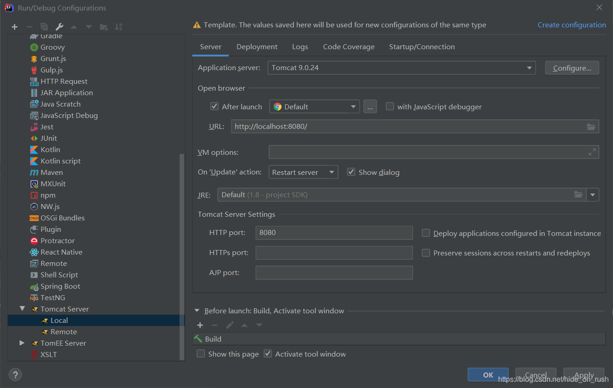  
切换到Deployment选项页 点击 + 号选择 Arctifact ，  
添加 项目名:war exploded 打包  
最后在Application context 中选择 空白 那一项，点击 Apply 应用。  
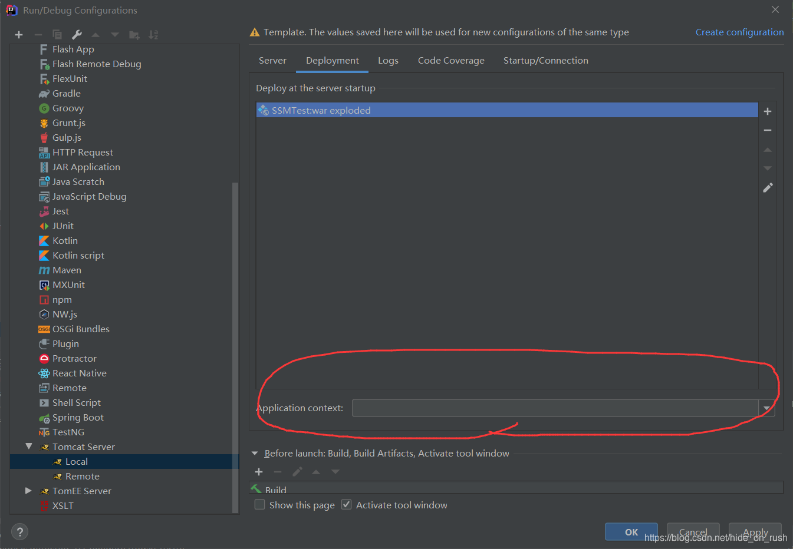  
最后切换到index.jsp界面，右键运行项目

## 问题

### 1.Cannot resolve bean 'dataSource'

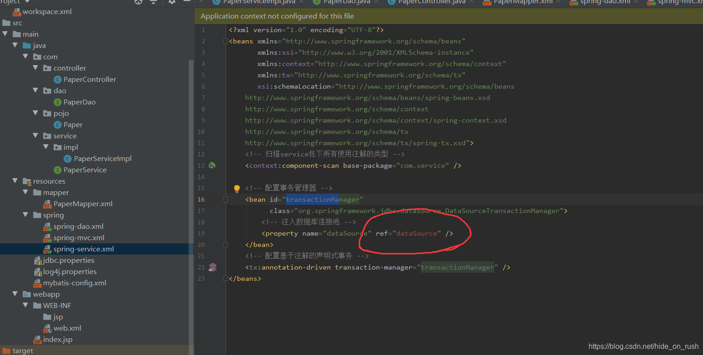  
此处的dataSource是在Spring-Dao.xml中配置的。本来是想直接引用过来，没想到会出现无法解析的错误  
解决方法：  
因为spring的配置文件没有全部导进来，所以在使用IDEA时需要自己手动导入  
1、点击右上角的Project Structure-->Modules发现spring什么也没有导入  
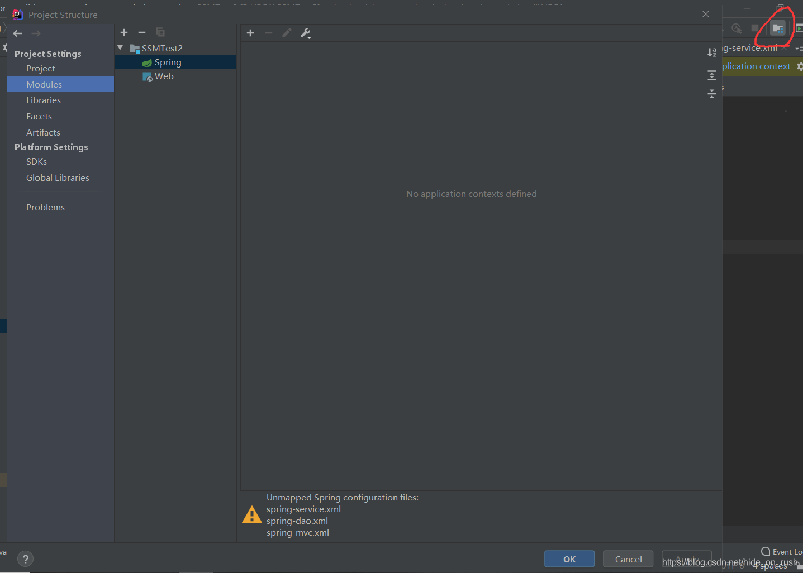  
2.  
点加号并选中文件。name那里不用改。  
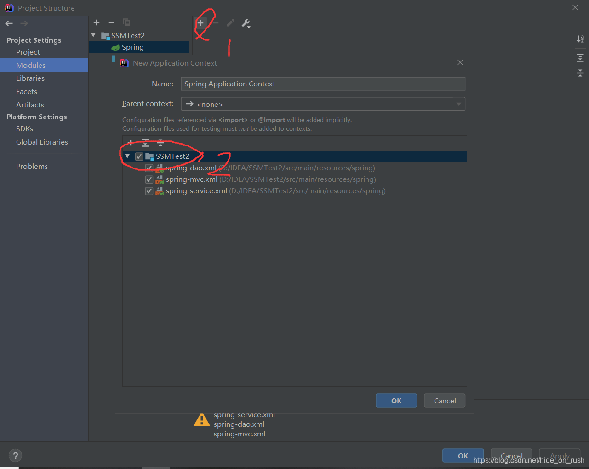  
返回发现恢复正常

### 2.点击进入管理页面500

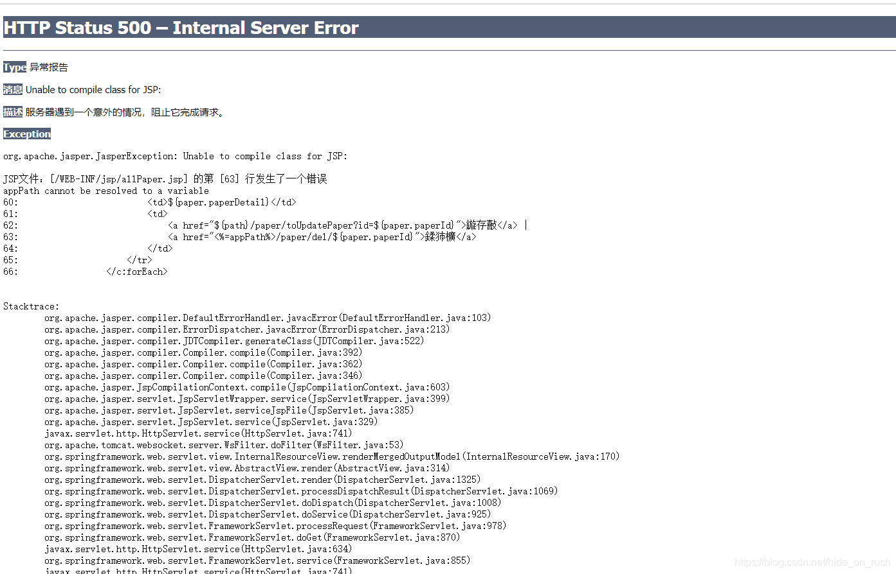  
这个应该是连接不上数据库的问题，在jdbc.url的链接后面加上&useSSL=false&serverTimezone=UTC即可。

## 最终结果

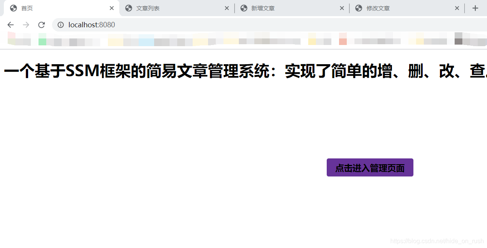  
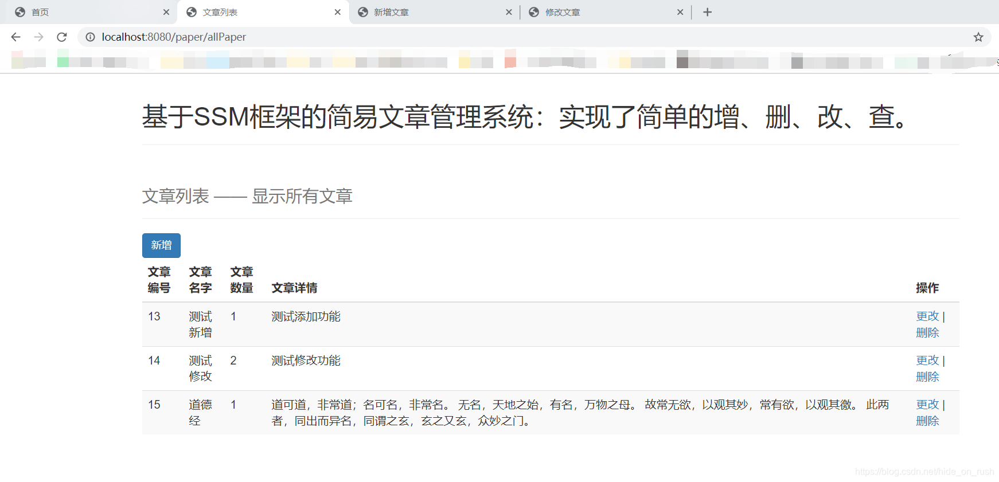  
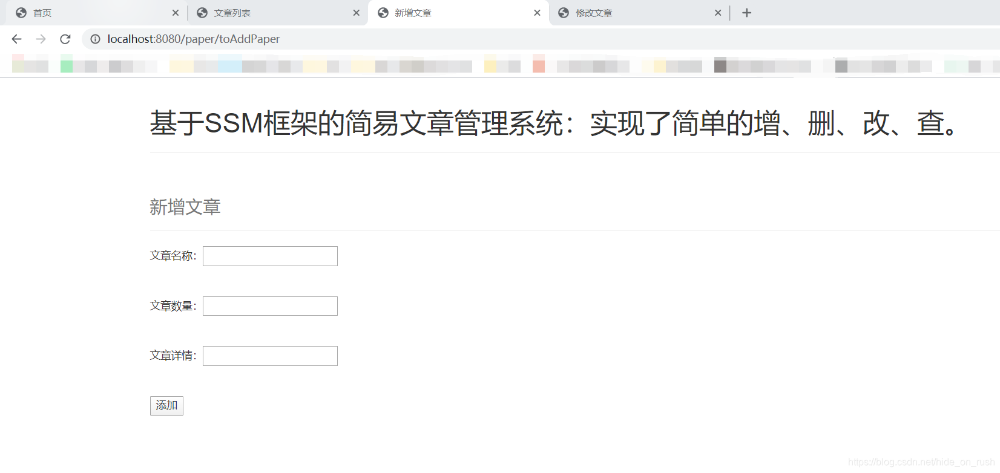  
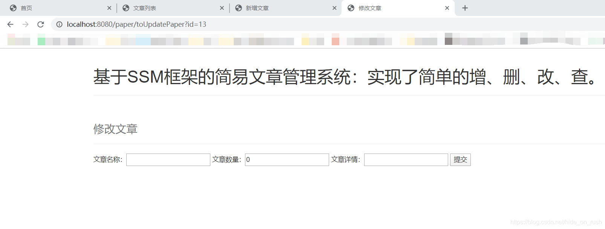
